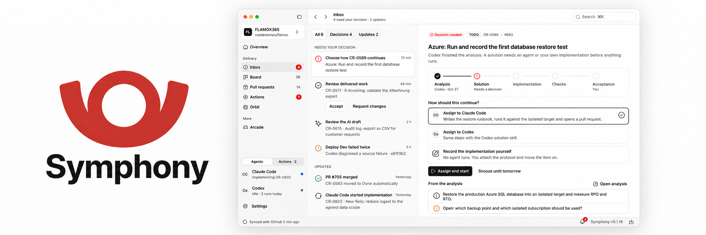

<p align="center">
  
</p>

# Symphony

**Bring your project board, coding agents, and delivery work into one desktop workspace.**

Isolated Git worktrees. Resumable agent runs. Pull requests and checks in context. Local execution state.

[](https://github.com/pixel-brewery/symphony/actions/workflows/ci.yml)
[](https://github.com/pixel-brewery/symphony/actions/workflows/release.yml)
[](LICENSE)

[Install](#install) · [Workflow](#from-board-to-reviewed-change) · [Capabilities](#what-it-does) · [Build from source](#build-from-source) · [Documentation](docs/README.md) · [Contributing](CONTRIBUTING.md)

> **Public release preparation.** Source and release configuration target
> [pixel-brewery/symphony](https://github.com/pixel-brewery/symphony). Publication still
> requires the owner handover, public visibility, usable Actions capacity, and a working
> update feed. The [handover guide](docs/architecture/application-updates/packaging.md)
> records the activation requirements. Prepared configuration alone does not make an
> installer or update available.

## From board to reviewed change

A local-first Electron application for coordinating provider-neutral software-delivery
workflows. Symphony projects a GitHub Projects board into a desktop workspace, prepares
isolated Git worktrees, runs coding agents against them under explicit control, and tracks
the resulting pull requests and checks on your machine.

| Step                      | Work in Symphony                                                                                                                                         |
| ------------------------- | -------------------------------------------------------------------------------------------------------------------------------------------------------- |
| **Connect the project**   | Select the GitHub Project and review detected repository, ticket-source, and CLI-account connections before applying the setup.                          |
| **Prepare the workspace** | Choose a work item and explicitly prepare its managed Git worktree. Keep implementation work isolated from your ordinary checkout.                       |
| **Analyze and implement** | Start an Analyzer or Solver run under the configured execution policy. Pause and resume durable runs as work progresses.                                 |
| **Review the result**     | Follow pull requests, local verification, GitHub Actions runs, and checks beside the work item. Keep delivery and environment-review decisions explicit. |

The GitHub CLI and the agent CLIs own their authentication. Symphony stores settings,
machine paths and execution state under `~/.symphony/`. Azure DevOps credentials supplied
through its connection flow are stored separately as operating-system-encrypted vault
blobs; settings retain non-secret references.

## Install

Download the latest build for your platform from
[Releases](https://github.com/pixel-brewery/symphony/releases/latest):

| Platform              | Asset                                 |
| --------------------- | ------------------------------------- |
| macOS (Apple Silicon) | `Symphony-darwin-arm64-<version>.dmg` |
| Windows (ARM64)       | `SymphonySetup.exe`                   |
| Linux (ARM64)         | `symphony_<version>_arm64.deb`        |

GitHub adds the source ZIP and source `tar.gz` links automatically. Symphony publishes no other
ZIP, x64, or NuGet release assets. When the app is built without Apple credentials, its bundle is
completely ad-hoc signed but is neither trusted by a Developer ID nor notarized. After copying it
to Applications, macOS therefore requires an explicit approval under **System Settings → Privacy
& Security → Open Anyway**. If Gatekeeper still reports a checksum-verified app as damaged, remove
only the browser quarantine with
`xattr -dr com.apple.quarantine /Applications/Symphony.app`.

Installer-only ARM64 releases are replaced manually. The ZIP and NuGet payloads required by
Electron's native automatic updaters are intentionally disabled and remain commented in the
release configuration for a later support expansion.

### What you need alongside it

- The [GitHub CLI](https://cli.github.com), authenticated, for the GitHub Projects board,
  pull requests, and checks
- At least one agent CLI — Claude Code, Codex, or OpenCode — for execution features
- Git

## What it does

- **Production orbit and Stages.** The default Memphis workspace shows employees, workflow
  phases and confirmed delivery destinations. Search and selection are shared with the Board;
  the previous Home overview remains at `/main/home`. Spatial mode loads Three.js on demand.
- **Project setup.** Review detected repository, ticket-source and CLI-account connections
  before applying the proposal. One employee can start with the shipped read-only analysis
  role; delivery targets and specialists can follow later.
- **Board.** The active work source is projected from a GitHub Project. Starting analysis
  or implementation updates the Project's Status and Assistant phase fields and verifies
  the persisted values before an agent runs.
- **Workspaces.** Each work item gets a managed Git worktree below `~/.symphony/workspaces`,
  prepared and cleaned up explicitly rather than by convention.
- **Agent execution.** Analyzer and Solver runs are durable: they can be paused, resumed
  from a stored continuation, and survive an application restart or an update installation.
- **Delivery.** GitHub deployment evidence, explicit release channels and installation
  receipts remain distinct. Revision-bound workflow graphs, declared dispatch inputs and
  environment reviews use typed operations and durable submission journals. See
  [production orbit](docs/architecture/production-orbit.md) for setup and workflow requirements.
  Pull requests, GitHub Actions runs, and check results are tracked next to
  the work item that produced them, with local verification and a managed local CI option.
- **Autonomy, off by default.** When deliberately enabled, the supervised background
  process schedules bounded backlog analysis, implementation of ready work, re-analysis of
  failures, and pull-request synchronization without an open window. See
  [autonomous execution](docs/architecture/autonomous-execution.md).
- **Mobile companion.** An optional Angular PWA served on one selected private local
  network interface, behind pairing and authorization. See
  [mobile companion](docs/architecture/mobile-companion-phase-1.md).

## Architecture

The runtime path is Renderer → sandboxed Preload → Electron Main → Utility Process. Zod
validates every request and every response at the boundary. The Angular renderer has no
Node.js access; only the Utility Process touches SQLite, Git, the GitHub CLI, and agent
CLIs. Electron Main owns lifecycle, IPC routing, and the compiled-in update origin.

Start with [system overview](docs/architecture/system-overview.md),
[process model](docs/architecture/process-model.md),
[security model](docs/architecture/security-model.md), and the
[IPC model](docs/architecture/ipc-model.md). Decisions are recorded as
[ADRs](docs/adr/README.md), and remaining production-adapter work is tracked in
[the roadmap](docs/roadmap.md).

## Build from source

> [!IMPORTANT]
> Symphony installs the `@pixel-brewery` design-system packages from GitHub Packages.
> Export a GitHub token with `read:packages` as `GITHUB_TOKEN` before installing dependencies.

Requires Node.js 24.15 or newer, Corepack, and Python 3.

```bash
corepack enable
export GITHUB_TOKEN=YOUR_GITHUB_PAT
yarn install
yarn dev
```

`yarn dev` serves the renderer on `127.0.0.1:4200` and launches Electron against it.
`yarn start` packages the application with Electron Forge and runs the packaged bundle,
which is what you want when checking icons, bundle names, or anything else the operating
system sees.

Quality gates:

```bash
yarn verify        # agents:check, ui:check, format:check, lint, typecheck, test, build
yarn e2e           # real three-process Electron app under Playwright, hidden locally
yarn e2e:visible   # opt into native windows for local lifecycle debugging
yarn forge:package # packaging smoke test
```

Full contributor guidance is in [CONTRIBUTING.md](CONTRIBUTING.md), and the authoritative
repository rules are in [AGENTS.md](AGENTS.md).

## Releases and updates

After the Pixel Brewery public handover, each source change on `main` requests a
semantic patch release. Nx Release prepares the root package version, conventional-commit
changelog, release commit, and `v<version>` tag once. Verification and all native builds use
that same prepared commit. Only after those gates succeed does the pipeline atomically push
the release commit and tag, then publish the macOS ARM64 DMG, Windows ARM64 EXE, and Linux ARM64 DEB as GitHub Release
assets. GitHub supplies the two source archives automatically. The pipeline verifies that no other
configured asset was attached before it publishes the immutable version manifest.

Platform signing credentials are optional. Complete macOS signing, Apple notarization, or Windows
signing secret groups enable the corresponding capability; absent or partial groups produce an
ad-hoc-signed, unnotarized macOS artifact or an unsigned Windows artifact with a workflow warning
instead of blocking the release. The Debian artifact is published without package signing.
Untrusted downloads can trigger Gatekeeper or SmartScreen warnings and should be installed only
after the release-manifest checksums have been verified. Patch, minor, and major releases can also
be requested explicitly from an authenticated checkout:

```bash
yarn release:patch
yarn release:minor
yarn release:major
yarn release:dry-run
```

The first three commands dispatch the release workflow against `main`; the dry run previews Nx's
next patch version and changelog locally. There are no release branches, and contributors must not
edit `package.json` or `CHANGELOG.md` to prepare a release by hand.

The complete feed layout, channel policy, signing requirements, and recovery model are
described in [desktop updates](docs/architecture/application-updates/README.md). The
[deployment guide](docs/architecture/application-updates/packaging.md) records the remaining
owner, public-visibility and feed activation steps.

## Repository assistants and portable skills

Repository guidance follows the same synchronized architecture used by the FLAMOX365
reference, adapted to Symphony's Electron and orchestration boundaries. Editable portable
skills live in `.agents/skills/`; deterministic ChatGPT-compatible `.skill` archives live
in `.agents/packages/`. Agent descriptions and scoped rules live under `.github/`, while
the Codex and OpenCode adapters are generated.

```bash
yarn agents:sync
yarn agents:check
yarn skills:package
```

See [repository AI configuration](docs/architecture/repository-ai-configuration.md) for
ownership, the update flow, and deliberate differences from the reference.

## Contributing and security

Issues and pull requests are welcome — start with [CONTRIBUTING.md](CONTRIBUTING.md) and
the [Code of Conduct](CODE_OF_CONDUCT.md). Report vulnerabilities privately through
[GitHub Security Advisories](https://github.com/pixel-brewery/symphony/security/advisories/new),
never in a public issue; the scope and the trust boundaries are in [SECURITY.md](SECURITY.md).

## License

[MIT](LICENSE). Symphony bundles Electron, Angular, and the Mosaik design system, each
under its own license.
