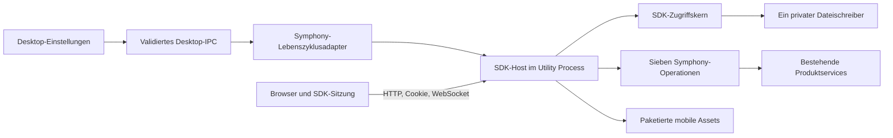

# Mobiler Zugang und gemeinsame Remote-Sitzungen

**Dokumentstatus:** Migrationsvertrag

Diese Seite definiert den Übergang vom Symphony-eigenen Pairing- und HTTP-Kern auf die produktneutralen Pakete `@pixel-brewery/remote-*` in Version `0.1.0`. Die beschriebenen Adapter und Migrationen liegen als Produktquellen vor. Die Integration gilt erst nach Paketauflösung, vollständigen Symphony-Prüfungen und dem unten beschriebenen echten Browser-/Electron-Nachweis als abgeschlossen; Quellcode und vorhandene Specs allein ersetzen diesen Nachweis nicht. Das [Produkthandbuch](../../project/system/mobile-access.md) beschreibt die Bedienung.

## Ergebnis und Grenzen

Symphony liefert seine browserfähige Begleitoberfläche als lokale, mit der Desktop-Anwendung paketierte Assets aus. Ein beliebiger Browser im privaten LAN oder WLAN kann sie öffnen. Ein QR-Code enthält eine fünf Minuten gültige Einladung. Der Besitz dieser Einladung autorisiert genau ein Gerät; eine zweite Bestätigung oder ein zusätzlicher Prüfcode ist im Symphony-Standardablauf nicht erforderlich.

Die Desktop-Installation bleibt die einzige Instanz für Arbeit, Daten, Providerzugriffe und Produktentscheidungen. Aktivierung, Gerätezulassung, Pairing und Transport gehören zu einem gemeinsamen SDK-Host und einem einzigen SDK-Zugriffskern. Symphony besitzt die ausgewählten Produktoperationen, Datenprojektionen, Assets, Konfiguration und dauerhafte Datei. Ein Gerät erhält weder allgemeines IPC noch einen Dateizugriff oder einen beliebigen Methodenaufruf.

Phase eins benötigt weder eine eigene Domäne noch einen gehosteten Dienst. Sie verwendet HTTP und WebSocket auf einer ausgewählten privaten Schnittstelle. Die von ADR-006 festgelegte Beschränkung auf einen Entwicklungs-PoC in einem ausdrücklich vertrauten Testnetz mit synthetischen oder nicht sensiblen Daten bleibt bestehen. Das Scannen legitimiert den Zugang, verschlüsselt aber keinen HTTP-Verkehr. Ein öffentlich vertrauenswürdiger HTTPS-Endpunkt ist kein Ergebnis dieser Migration.

## Verantwortungen und Abhängigkeiten

| Verantwortung                                                                                  | Eigentümer                                                                                          | Vertrag                                                                                                                                                 |
| ---------------------------------------------------------------------------------------------- | --------------------------------------------------------------------------------------------------- | ------------------------------------------------------------------------------------------------------------------------------------------------------- |
| Einladungen, Gerätezulassung, Entzug und Aktivierungspräferenz                                 | Ein `RemoteAccessService` je Symphony-Installation                                                  | Asynchroner atomarer Store, Kryptographie, Uhr, Produktfähigkeiten und Policy `qr-possession`                                                           |
| Listener, private Adressen, Host-/Origin-Prüfung, Cookies, Assets, HTTP-/WebSocket-Lebensdauer | Ein `NodeRemoteHost` hinter einer SDK-`RemoteHostRuntime` im Orchestrator Utility Process           | Explizite Routen und ein Produktadapter mit Original-Request/-Response und Abbruchsignal; die Runtime serialisiert alle Lebenszyklus- und Gerätebefehle |
| Autorisierte Snapshot-Projektion und aktuelle Produktvalidierung                               | Symphony-Produktadapter                                                                             | Sieben benannte Operationen; vorhandene Domain-, Workspace-, Workflow- und Speicherregeln                                                               |
| Dauerhafte Installationskennung, Grant-Datei und Nutzungszeitpunkte                            | Symphony-eigener Store                                                                              | Ein serialisierter Schreiber für SDK-Zustand und Produktbeobachtungen                                                                                   |
| Browser-Pairing, Sitzungsprüfung, Verbindungswiederherstellung und begrenzte Events            | SDK `BrowserRemoteApp` (mit `RemoteSession` und `BrowserRemoteConnector`) und `BrowserRemoteEvents` | Gleicher Origin, HttpOnly-Cookie, Identitätsprüfung, keine Wiederholung von Schreiboperationen; eine neue Einladung im selben Tab koppelt erneut        |
| Ansichten, Projektionen, Entwürfe und Benutzeraktionen                                         | Bestehende mobile Symphony-Features                                                                 | Kleiner Produktclient-Port und validierte mobile DTOs                                                                                                   |
| Prozessstart, Beenden und Betriebssystem-Lebensdauer                                           | Bestehende Desktop-/Utility-Supervision                                                             | Typisierter Renderer → Preload → Main → Utility-Pfad                                                                                                    |
| Zertifikate und Browser-Vertrauensintegration bei späterem HTTPS                               | Symphony                                                                                            | App-eigener TLS-Provider; das SDK enthält weder Produktzertifikat noch Aussteller oder Domäne                                                           |

Portable mobile Verträge dürfen weder Node noch Electron importieren. Der Browser importiert ausschließlich portable SDK-Pakete. Der Node-Host und die Dateiimplementierung verbleiben im Orchestrator. Es gibt keinen zweiten Pairing-Service, separaten generischen HTTP-Router oder Renderer-seitigen Persistenzschreiber.



## Identität und Pairing

Die stabile Identität besteht aus `{ appId: 'symphony', hostId }`. `hostId` wird einmal kryptographisch zufällig erzeugt und vor dem Start des SDK-Kerns dauerhaft gespeichert. Weder Rechnername, aktuelle IP-Adresse noch Port ersetzen diese Kennung. Ein anderes Produkt oder eine andere Installation kann nicht durch eine neue Adresse dieselbe Sitzung übernehmen.

Der Ablauf lautet:

1. Die Desktop-Administration erzeugt eine Einladung nur bei verfügbarem Host. Das SDK erzeugt 32 Zufallsbytes und eine exklusive Ablaufzeit nach fünf Minuten. Im Einladungsspeicher bleibt der Challenge-Hash.
2. Die kopierbare Adresse hat den aktuellen privaten Origin und ein Fragment der Form `/#pair=…&app=symphony&host=…&expires=…`. Das Fragment wird nicht als HTTP-Request-Ziel übertragen. Die ganze Adresse ist trotzdem ein vorübergehendes Zugangsgeheimnis und gehört nicht in Logs.
3. Der Browser liest die vollständige Einladung und prüft Produkt, Installationskennung, Origin und Ablaufzeit. Er erstellt eine zufällige `attemptId` und sendet die kanonische SDK-Anfrage mit Gerätename und `credentialMode: 'cookie'`.
4. Die erste gültige Verwendung bindet die Einladung an genau diese Versuchkennung, denselben Gerätenamen und denselben Credential-Modus. Derselbe Versuch kann bei einer verlorenen Antwort bis zum Ablauf wiederholt werden. Eine andere Versuchkennung erhält keine zweite Zulassung.
5. Der SDK-Kern speichert den vollständigen neuen Grant atomar, bevor er Erfolg meldet. Ein Speicherfehler erzeugt keinen bestätigten Grant. Nach Erfolg erhält ausschließlich dieser Browser seinen zufälligen Sitzungsnachweis; es wird kein X.509-Gerätezertifikat benötigt.
6. Der Host setzt den zufälligen Nachweis als Cookie `symphony_mobile` mit `HttpOnly; SameSite=Strict; Path=/; Max-Age=31536000`; bei HTTPS kommt `Secure` hinzu. Der Cookie-Modus gibt keinen Bearer im JSON an JavaScript zurück. Die Datei enthält ausschließlich dessen SHA-256-Hash.
7. Nach bestätigter Sitzung entfernt der Browser die Einladung aus der Adresszeile. Für einen Reload während einer verlorenen Antwort speichert er höchstens einen öffentlichen Datensatz `{ hostId, expiresAt, attemptId }` unter `symphony.remote.pending-attempt` in `sessionStorage`. Challenge und dauerhafter Nachweis gehören dort nicht hinein. Nach Erfolg verschwindet auch dieser Datensatz.

Das SDK unterstützt eine zusätzliche Host-Freigabepolicy für andere Anwendungen. Symphony aktiviert sie nicht. Die bisherigen typisierten Desktop-Methoden zum Freigeben/Ablehnen bleiben kompatible Delegationen; `pendingPairings` ist im Standardablauf leer. Der mobile Browser besitzt keinen zweiten Freigabe- oder Statuspolling-Automaten.

Das Anlegen eines weiteren QR-Codes entzieht bereits gekoppelten Geräten keinen Zugang. Eine noch unbenutzte Einladung läuft unabhängig nach ihrer eigenen Frist ab. Netzwerkwechsel, Ausschalten und ein Entzug aller Geräte invalidieren offene Einladungen.

## Reservierte SDK- und Produktverträge

Die SDK-Routen sind `/__remote/v1/host` für die öffentliche Identität, `/__remote/v1/pairings` für Pairing sowie `/__remote/v1/session` für Sitzungsprüfung und Sitzungsentzug. Sie gehören dem SDK und können nicht als Produktoperation überschrieben werden. Der öffentliche Hostdatensatz enthält weder Daten noch Credentials. Ein Produktlesezugriff ist erst nach Sitzungsprüfung zulässig.

Symphony registriert genau diese Produktoperationen:

| Methode und Pfad                                  | Operationskennung         | Fähigkeit             | Produktprüfung                                                                   |
| ------------------------------------------------- | ------------------------- | --------------------- | -------------------------------------------------------------------------------- |
| `GET /api/mobile/v1/snapshot`                     | `mobile.snapshot`         | `symphony:read`       | Aktueller ausgewählter Workspace-Umfang, explizite DTO-Projektion                |
| `POST /api/mobile/v1/work-items/creation-context` | `mobile.creation-context` | `symphony:read`       | Genau ein aktiver Workspace und aktuell erlaubtes Repository                     |
| `POST /api/mobile/v1/work-items`                  | `mobile.work-item.create` | `symphony:work-items` | Aktueller Workspace, Repository, Labels, Assignees, Feldtypen und Optionen       |
| `POST /api/mobile/v1/work-items/draft`            | `mobile.draft`            | `symphony:work-items` | Aktueller Erstellungskontext, Speicherzulassung, identifizierter Entwurfsauftrag |
| `POST /api/mobile/v1/work-items/draft/cancel`     | `mobile.draft.cancel`     | `symphony:work-items` | Exakte `operationId` des Entwurfs                                                |
| `POST /api/mobile/v1/commands`                    | `mobile.commands`         | `symphony:commands`   | Aktueller Snapshot, zustandszulässige Ticketaktion und deren konkrete Ressourcen |
| `GET /api/mobile/v1/events` mit WebSocket-Upgrade | `mobile.events`           | `symphony:read`       | Autorisierter Gerätelebenszyklus; ausschließlich typisierte Invalidierung        |

Die drei Produktfähigkeiten werden bei QR-Kopplung als explizite Liste vergeben. Sie erlauben ausschließlich diese registrierten Produktoperationen. Die ausgewählten Workspace-IDs werden weiterhin durch den kanonischen Desktop-Zustand bestimmt; der Browser kann den Umfang nicht durch einen beliebigen Parameter erweitern.

Alle POST-Operationen verwenden JSON und ein Budget von vier MiB. Nur der Snapshot ist als sicher erneut lesbar gekennzeichnet. Auch der lesende Erstellungskontext bleibt als POST ohne automatische Wiederholung registriert. Ein verlorenes Schreibergebnis wird als unklarer Ausgang gemeldet. Der Browser prüft anschließend den aktuellen Produktzustand und startet die Mutation nicht automatisch erneut.

`mobile.commands` enthält ausschließlich die vorhandenen Aktionen `analyze`, `solve`, `remove-queue-entry`, `cancel-execution`, `publish-pull-request`, `decide` und `move`. Vor der Domain-Operation wird ein neuer Snapshot gelesen. Eine Analyse oder Lösung muss jetzt angeboten und ungesperrt sein; eine Rework-Aktion braucht den geforderten Feedbacktext. Eine Veröffentlichung muss zur aktuell angebotenen Ausführung gehören. Abbruch und Queue-Entfernung müssen eine noch aktive beziehungsweise wartende Ressource treffen. Eine Workflowentscheidung muss aktuell angeboten sein. Verschieben ist nur in eine Spalte des Boards des betreffenden Tickets zulässig. Nach asynchroner Eingabe- und Metadatenvalidierung wird das SDK-Abbruchsignal vor einer neuen Produktmutation erneut geprüft.

Domain-Services behalten ihre bestehenden Speicher-, Ausführungs-, Workspace- und Zustandsregeln. Eine abgewiesene Produktprüfung führt nicht zu einem privilegierten alternativen Dispatch.

Für Analyse, Lösung und Ticketverschiebung reicht der Produktadapter dasselbe SDK-Requestsignal verpflichtend an die Kompositionscallbacks weiter. Diese warten auf die bestehende Speicherzulassung, die selbst einen weiteren Snapshot lesen kann, und prüfen direkt danach das Signal, bevor sie Ausführungszulassung beziehungsweise Provider-Schreiboperation aufrufen. Ein Entzug oder Verbindungsabbruch während dieser Prüfung erzeugt keine neue Ausführung, keinen Queueeintrag und keine Verschiebung. Der Adapter schließt die abgebrochene Antwort ohne einen zusätzlichen Produktfehler zu protokollieren. Bereits an ihren Domain-Eigentümer übergebene Operationen behalten dessen Lebenszyklus; ein Transportabbruch verspricht keinen Rollback bereits erfolgter Änderungen.

## Datenprojektionen

Der Produktadapter wählt Felder einzeln aus und validiert das Ergebnis vor dem Versand. Er überträgt keine vollständige Orchestrator-Snapshot- oder Settings-Struktur.

Der mobile Snapshot enthält die aktuelle Desktop-Bezeichnung, Zeitpunkt, freigegebene Tickets und deren gültige Aktionen, providerneutrale Boardspalten, Ausführungen, Warteschlange, ausgewählte Pull Requests sowie die Darstellung und tatsächliche Aktivität ausgewählter Mitarbeiter. Ticket-URLs sind ausschließlich validierte HTTP(S)-Adressen. Ein ungültiger Link wird zusammen mit der davon abhängigen Remoteaktion ausgelassen; ein Pull Request ohne gültigen Link wird ausgelassen. Fortschritts- und Fehlertexte einer Ausführung sind auf 20.000 Zeichen begrenzt, ihre Zusammenfassung auf 1.000.000. Der Browser begrenzt das gesamte gelesene Produkt-JSON auf 32 MiB.

Die neue optionale `displaySettings`-Projektion ist ein strikter Vertrag in Version eins. Sie dient als sichere Datenbasis für gemeinsam nutzbare Betriebsansichten und enthält genau:

| Teil                        | Erlaubte Felder                                                                                     |
| --------------------------- | --------------------------------------------------------------------------------------------------- |
| `activeViewScope`           | `workspaceIds`, `boardLayout`, optional `savedViewId`, `workItemSourceId`                           |
| `workspaces`                | `id`, `displayName`, `shortCode`, `color`, optional portabler `avatar`, `enabled`                   |
| `repositories`              | `id`, `workspaceId`, `displayName`, `provider`, `host`, `owner`, `name`, `defaultBranch`, `enabled` |
| `workItemSources`           | `id`, `workspaceId`, `provider`, `displayName`, `enabled`                                           |
| `employees`                 | `id`, `workspaceId`, `displayName`, `positionId`, optionale validierte `appearance`, `enabled`      |
| `workflowStages`            | Geordnet `id`, `label`, `description`, `kind`                                                       |
| `automaticExecutionEnabled` | Boolean; keine Änderungsberechtigung                                                                |

Workspace-, Repository-, Source- und Mitarbeiterlisten werden auf die ausgewählten Workspace-IDs gefiltert. Die Appearance ist dieselbe mobile Darstellungsform mit bekannten Figuren, Farben und Accessoires sowie einem optionalen begrenzten PNG-Datenbild. Workspace-Avatare sind portable Symbole, Emojis oder Monogramme. Lokale Pfade, Worktree-Wurzeln, Providerverbindungen und deren Referenzen, Setup-Skripte, Modellrouten, Konten, Umgebungsvariablen und Secrets haben keine DTO-Felder. Zusätzliche Felder werden an den strikten Objektgrenzen abgelehnt. Die Projektion verwendet weder einen Settings-Cast noch ein Objekt-Spread des vollständigen Settings-Aggregats.

Die neue DTO-Datenbasis führt keine neue Settings-Schreibroute ein. Gemeinsame Desktopansichten dürfen künftig nur gegen den expliziten Anzeigevertrag komponiert werden; ihre Desktop-Administrationsports werden dadurch nicht remote erreichbar.

## Browser-Zustand und Events

Der browserseitige Produktport besitzt genau eine SDK-Sitzung. Beim Wiederöffnen ohne Einladung prüft er zunächst die öffentliche Symphony-Identität und restauriert anschließend den gleichnamigen HttpOnly-Cookie über die SDK-Sitzungsroute. Ein fremdes `appId` oder eine abweichende erwartete Installationskennung ist ein Fehler und keine automatische Neuzuordnung.

Die Produktzustände werden aus SDK-Sitzungszuständen abgeleitet. Nur eine verifizierte `ready`-Sitzung liefert Kopplungsbeweis. Ein Produkt-Snapshot mit Status 500 widerruft keine erfolgreiche Kopplung; die bestehende Fehler-/Wiederholen-Oberfläche bleibt erreichbar. Status 401 oder SDK-Entzug leert Snapshot und Erstellungskontext, schließt den Eventkanal und erhöht eine lokale Generation. Späte Ergebnisse der vorigen Generation dürfen diese Projektionen nicht wieder füllen.

Events bestehen aus `{ type: 'snapshot.invalidated', occurredAt }`. Sie enthalten keinen geheimen oder vollständigen Snapshot. Der Client validiert jede Nachricht. Nach Öffnen oder Wiederherstellung des Kanals liest er einen neuen Snapshot; das gilt auch nach einer zwischenzeitlichen Ereignislücke. Das SDK besitzt den einzigen Wiederverbindungsautomaten: höchstens acht aufeinanderfolgende Versuche mit 500 ms beginnendem exponentiellem Abstand und maximal 30 s Abstand. Nach mindestens fünf Sekunden stabiler Verbindung kann das Fehlerbudget zurückgesetzt werden. Pro Nachricht sind höchstens 65.536 Bytes zulässig.

Die ausdrückliche Wiederholen-Aktion schließt zuerst den bisherigen Event-Eigentümer einschließlich seiner geplanten Versuche und entfernt dessen Cleanup-Handle. Nach erfolgreicher Sitzungsprüfung und frischem validiertem Snapshot wird ein neuer SDK-Event-Eigentümer angelegt. Damit kann auch ein durch ausgeschöpftes Retrybudget oder einen endgültigen Close beendeter Kanal wiederhergestellt werden. Gewöhnliche Snapshot-Invalidierungen behalten den bestehenden Kanal; sie setzen kein Fehlerbudget zurück und erzeugen keinen zusätzlichen Wiederverbindungsautomaten. Ein erster Snapshotfehler mit Status 500 erhält weiterhin die verifizierte Kopplung und die vorhandene Fehler-/Wiederholen-Ansicht.

Symphony beendet langsame Eventempfänger, wenn deren Sendepuffer ein MiB überschreitet. Das SDK schließt Geräteströme bei erfolgreichem Entzug, Listenerwechsel und Dispose. Angular-Zerstörung entfernt Abonnements, beendet alle Eventkanäle, bricht ausstehende Sitzungs-/Produktlesezugriffe ab und schließt die SDK-Sitzung. Keine Produktklasse führt daneben einen eigenen WebSocket-Reconnect-Timer.

## Privater Host und Lebenszyklus

Ohne explizite Testkonfiguration wählt das SDK deterministisch eine nicht interne private IPv4-Adresse. Wi-Fi-/Ethernet-typische Adapter werden bevorzugt; Tunnel-, VPN-, Container-, Bridge- und VM-Adapter werden ausgeschlossen. Der Listener bindet die ausgewählte numerische Adresse, keinen Wildcard-Host, öffentlichen Host oder DNS-Namen. Fehlt eine geeignete Adresse, bleibt die gespeicherte Aktivierungsabsicht bestehen, während der Runtimezustand `unavailable` wird.

Der Defaultport beginnt bei 49152; ohne konfiguriertes Ende probiert der SDK-Host die folgenden 48 Alternativen. Eine explizite Spanne darf höchstens 128 Alternativen umfassen. Die Symphony-Komposition darf eine private Adresse und Portgrenzen für Betrieb und Tests liefern; die normale UI fragt sie nicht ab. Loopback ist ausschließlich mit dem ausdrücklichen Testschalter zulässig.

| Vorgang                         | Reihenfolge und Folge                                                                                                                                                                                                                                             |
| ------------------------------- | ----------------------------------------------------------------------------------------------------------------------------------------------------------------------------------------------------------------------------------------------------------------- |
| Start                           | Datei vollständig restaurieren/migrieren → Identität und Core initialisieren → bestehender Background-Koordinator führt Host-Reconciliation aus                                                                                                                   |
| Einschalten                     | Aktivierungsabsicht atomar speichern → private Schnittstelle wählen und binden → `available`; Bindefehler lässt die Absicht eingeschaltet                                                                                                                         |
| Ausschalten                     | Listener und laufende Transports schließen → deaktivierte Absicht speichern → `disabled`                                                                                                                                                                          |
| Speicherfehler beim Ausschalten | Runtime bleibt lokal gestoppt und meldet `unavailable`; die Hintergrund-Reconciliation darf die noch gespeicherte alte Absicht nicht wieder öffnen. Erst ausdrückliches Einschalten hebt diese lokale Sperre auf                                                  |
| Geräteentzug                    | Geänderten Grant-Zustand atomar speichern → SDK-Entzugsereignis → Requests und Events dieses Geräts abbrechen. Bei Speicherfehler bleibt der bisherige Grant maßgeblich und es wird kein Erfolg gemeldet                                                          |
| Netz-/Resume-Abgleich           | Hintergrundstart, Desktop-Resume/-Entsperren, Einschalten und jede neue Einladung lösen denselben serialisierten SDK-Abgleich aus; es gibt keinen Timer. Gleiche Adresse ist ein No-op; Wechsel schließt die alte Runtime, invalidiert Einladungen und bindet neu |
| Vollständiges Beenden           | SDK-Dispose schließt Listener, Requests, WebSockets und Abonnements; gespeicherte Aktivierungsabsicht und Grants bleiben erhalten                                                                                                                                 |

Die Hostgrenzen sind standardmäßig 128 TCP-Verbindungen, 64 aktive oder gerade öffnende WebSockets, 15 Sekunden für Header, 30 Sekunden für Request-Eingang und fünf Sekunden Keepalive. Pairing-JSON hat ein Budget von 16.384 Bytes; gleichzeitig gibt es höchstens 32 offene Einladungen und 100 Geräte. Nach höchstens einer Sekunde geordnetem Listener-Schließen werden verbleibende Sockets zerstört. Vor dem Produktadapter prüft der SDK-Host genau einen passenden Host-Header und verweigert einen vorhandenen fremden Origin beziehungsweise fremde Fetch-Metadaten. Ein fehlender Origin-Header ist zulässig. Die Netzwerkgrenze ist die ausgewählte private Bindeadresse; eine zusätzliche Prüfung jeder eingehenden Peer-Adresse ist dort nicht implementiert.

## Dauerhafter Zustand und Migration

Die bestehende Datei `mobile-access.json` bleibt das einzige Produktartefakt für Remote-Freigaben. Der neue Datensatz lautet semantisch:

```text
version: 1
identity: { appId: 'symphony', hostId: <einmal erzeugte UUID> }
enabled: boolean
devices: [
  { id, name, tokenHash: <64 hex SHA-256>, capabilities: [<Produktfähigkeiten>],
    pairedAt: <ISO-Zeit>, lastSeenAt?: <ISO-Zeit> }
]
```

Auch das alte Format trug `version: 1`. Deshalb darf der Versionswert allein niemals als Formatdiskriminator dienen:

1. Ist die Datei nicht vorhanden, wird ein deaktivierter Datensatz mit neuer Identität atomar angelegt.
2. Hat der gelesene Objektwert ein eigenes Feld `identity`, wird ausschließlich das neue strikte SDK-Schema geprüft. Malforme Kennungen, ein fremdes Produkt oder ungültige neue Daten sind ein Restorefehler. Es gibt keinen Rückfall auf den Legacyparser.
3. Ohne dieses Feld muss der komplette Datensatz dem strikten alten Vertrag `{ version: 1, enabled, devices }` entsprechen. Die Migration übernimmt `enabled`, jede Geräte-ID, Namen, `tokenHash`, `pairedAt` und optional `lastSeenAt` exakt. Sie ergänzt die einmal erzeugte Installationskennung und die drei Symphony-Fähigkeiten.
4. Der neue Datensatz wird vollständig validiert und atomar privat geschrieben, bevor der SDK-Kern gestartet wird. Fehlgeschlagene Legacy- oder neue Validierung erhält die Ursprungsdatei und startet keinen teilrestaurierten Host.

Vorhandene Token werden weder entschlüsselt noch rekonstruiert oder neu gehasht. Die unveränderte Cookie-Bezeichnung `symphony_mobile` ermöglicht, dass ein vorhandener Browsernachweis bei gleich gebliebenem Origin weiterhin gegen den alten SHA-256-Hash geprüft wird. Ein Wechsel der IP-Adresse oder des Hostnamens kann browserseitig trotzdem eine neue Kopplung erfordern, weil ein Cookie nicht auf einen anderen Host übertragen wird.

Alle SDK-Speicherungen und Produktbeobachtungen laufen durch dieselbe asynchrone Schreibwarteschlange. `recordActivity` aktualisiert nur den Zeitstempel eines dann noch vorhandenen Geräts. Ein späterer SDK-Zustand erhält bereits committed Nutzungsbeobachtungen für fortbestehende Geräte. Eine Beobachtung kann einen zuvor entzogenen Grant nicht wieder anlegen. Erst nach atomarem Erfolg wird der lokale committed Zustand ersetzt; öffentliche Fehler enthalten weder Dateipfad noch Rohursache.

Während des Übergangs darf der alte synchrone `JsonMobileAccessRepository` nicht neben dem SDK-Store weiter schreiben. Der alte Anwendungskern und seine ungenutzten Ports werden entfernt. Die alten mobilen Pairing-HTTP-Routen werden nicht mehr registriert. Ein bereits geöffneter alter Pairing-Browser muss die neu paketierte Anwendung laden und gegebenenfalls einen neuen QR-Code verwenden; ein dauerhaft gekoppelter Cookie bleibt wie beschrieben kompatibel.

Ein Downgrade auf eine Version ohne diese Migration ist kein unterstützter gemeinsamer Schreibbetrieb. Vor einem bewussten Rollback müssen Utility und Listener gestoppt sein und eine private, vor der Migration angelegte Sicherung separat erhalten werden. Das neue Format darf nicht durch einen alten Writer geöffnet und ohne Identität überschrieben werden. Ein Zustand, der nach der Migration neue Zulassungen oder Entzüge enthält, darf nicht still durch eine alte Sicherung ersetzt werden.

## Zertifikate und Transportaustausch

Das SDK enthält nur den injizierbaren TLS-Vertrag und HTTP-/HTTPS-Listeneradapter. Es besitzt keine Symphony- oder Weasel-Zertifikate, gemeinsame private Schlüssel, Domänen oder Zertifikatsausstellung. Jede App verwaltet bei HTTPS ihren Installationsschlüssel, Ausstellung, Speicherung, Erneuerung und den browserseitigen Vertrauensweg. Ein von der App selbst erzeugtes Zertifikat ist ohne zusätzliche Vertrauensinstallation nicht automatisch im beliebigen Browser vertrauenswürdig.

Die aktuelle Symphony-Komposition liefert bewusst keinen TLS-Provider und keine Ausstellungsinfrastruktur; sie verwendet den lokalen HTTP-Adapter der ersten Phase. Ein späterer produktseitiger TLS-Provider oder ein anderer Transport darf Hostidentität, Geräteberechtigungen, Route-Registry und Produktadapter weiterverwenden. Dafür ist keine zweite Kopie der Pairinglogik zulässig. Öffentlicher Relaybetrieb, Hosting, DNS und Zertifikatsdienste sind keine verdeckten Runtime-Voraussetzungen dieser lokalen Integration.

## Paketierung, Konfiguration und Diagnose

`apps/mobile` bleibt ein eigener Angular-Build aus browserfähigen bestehenden Frontend-Features. Es importiert weder `apps/renderer` noch Electron-/Node-Module. Presenter, Mosaik-Komponenten, das bestehende mobile Theme, lokale PNG-Figuren und Schriftdateien bleiben die Darstellungseigentümer. Die Migration führt kein neues Template oder Styling ein. Kritische CSS-Inlining-Handler bleiben im Produktionsbuild ausgeschaltet; externe Script-/Stylesheet-Assets funktionieren unter der bestehenden Content Security Policy.

Die Symphony-eigene Assetpolicy lautet `default-src 'self'; script-src 'self'; style-src 'self' 'unsafe-inline'; img-src 'self' data:; font-src 'self' data:; connect-src 'self' ws: wss:; frame-ancestors 'none'; base-uri 'self'`. Der SDK-Host liefert ausschließlich das kanonisch aufgelöste Paketverzeichnis aus und verweigert Ausbrüche über Pfade oder Symlinks. Kein Entwicklungsserver und kein Quellverzeichnis darf im gepackten Produkt notwendig sein.

| Konfiguration                         | Bedeutung                                                                                                        |
| ------------------------------------- | ---------------------------------------------------------------------------------------------------------------- |
| `SYMPHONY_MOBILE_ACCESS_PATH`         | Optionaler Test-/Betriebspfad der privaten Autorisierungsdatei; regulär im vorhandenen Konfigurationsverzeichnis |
| `SYMPHONY_MOBILE_ASSETS_PATH`         | Paketierter unveränderlicher mobiler Assetroot                                                                   |
| `SYMPHONY_MOBILE_HOST`                | Optional ausdrücklich ausgewählte private numerische Schnittstelle                                               |
| `SYMPHONY_MOBILE_PORT_START` / `_END` | Validierte TCP-Ports 1 bis 65535; SDK prüft Reihenfolge und Spanne                                               |
| `SYMPHONY_MOBILE_ALLOW_TEST_LOOPBACK` | Nur der exakte Wert `1` erlaubt isolierten Loopbacktests den Testbetrieb                                         |

`mobile.request.failed` enthält Produktmethode, queryfreien Pfad, Status, stabilen Code und bei Antwortvalidierung nur Zod-Issuecodes/Feldpfade. `mobile.transport.failed` enthält ausschließlich SDK-Operation und stabilen Code. Logs enthalten weder Einladung, Cookie, Bearer, Hash, eingereichte Daten noch private Rohursachen. Der Desktop erhält eine kurze credentialfreie Statusprojektion mit Verfügbarkeit, aktueller Adresse, Geräten und committed letzter Nutzung. Kein allgemeines Health- oder Infrastrukturpanel wird ergänzt.

Der Renderer fragt diesen Status nicht periodisch ab. Der Gateway meldet SDK-Zugriffsereignisse (gekoppelt, entzogen, Einladungen invalidiert, ausgeschaltet), jeden Wechsel der verbundenen Geräte und das Ende jedes Lebenszyklusbefehls (Start, Ein-/Ausschalten, Abgleich, Einladung; auch bei Fehlern) über die nutzlastfreie Utility-Nachricht `mobile-access.changed`. Meldet ein neu gestarteter Utility Process seine Bereitschaft, sendet Main dieselbe Meldung. Main leitet sie auf dem festen Kanal `orchestration:mobile-access-changed` weiter, der Preload stellt sie als `onMobileAccessChanged` bereit, und der `MobileAccessStore` liest daraufhin den Status über die validierte Anfrage `mobile-access.status.get`. Die Nachricht enthält weder Status noch Gerätedaten. Ein bloßer neuer Nutzungszeitpunkt löst keine Nachricht aus; er erscheint mit dem nächsten Statuslesen, spätestens wenn die Karte erneut geöffnet wird.

## Implementierungsabbildung

| Semantischer Eigentümer                                     | Aktuelle Symphony-Quelle                                                                                                                                                                                         |
| ----------------------------------------------------------- | ---------------------------------------------------------------------------------------------------------------------------------------------------------------------------------------------------------------- |
| Bootstrap und einmaliger SDK-Core                           | `apps/orchestrator/src/main.ts`, mobiler Initialisierungsblock                                                                                                                                                   |
| SDK-Host-Lebenszyklus, Desktopstatus und Änderungsmeldungen | `apps/orchestrator/src/mobile-gateway/LocalMobileGateway.ts`                                                                                                                                                     |
| Nutzlastfreie Statusänderungsmeldung                        | `libs/ipc-contracts/features/mobile/src/lib/MobileAccessChangedEnvelopeSchema.ts`, `apps/desktop/src/main.ts`, `apps/desktop/src/preload.ts`, `libs/frontend/features/mobile/src/lib/state/MobileAccessStore.ts` |
| Produktdispatch und Snapshot                                | `apps/orchestrator/src/mobile-gateway/SymphonyMobileApplicationAdapter.ts`                                                                                                                                       |
| Strikte Settings-Anzeigeprojektion                          | `apps/orchestrator/src/mobile-gateway/projectMobileDisplaySettings.ts` und `libs/mobile-contracts/src/lib/remote/MobileDisplaySettingsSchema.ts`                                                                 |
| Sieben Routen und Fähigkeiten                               | `libs/mobile-contracts/src/lib/remote/SymphonyRemoteRoutes.ts`, `SymphonyRemoteCapabilities.ts`                                                                                                                  |
| Domain-Komposition und validierte Desktopbefehle            | `apps/orchestrator/src/features/mobile/createMobileGateway.ts`, `provideMobileOrchestratorFeature.ts`                                                                                                            |
| Migration und einziger privater Schreiber                   | `libs/persistence/features/mobile/src/lib/remote/SymphonyRemoteAccessStore.ts`                                                                                                                                   |
| Browser-SDK-Komposition                                     | `libs/frontend/features/mobile/src/lib/browser/clients/BrowserMobileCompanionClient.ts`                                                                                                                          |
| Produktprojektionen und Generationenschutz                  | `libs/frontend/features/mobile/src/lib/browser/state/MobileCompanionStore.ts`                                                                                                                                    |
| Paketierter Browserbuild                                    | `apps/mobile` und bestehende mobile Frontend-Presentation-/Feature-Views                                                                                                                                         |

## Nachweisbarer Abschluss

Die Migration ist erst abgeschlossen, wenn diese Nachweise gegen die tatsächlich aufgelösten SDK-Pakete erfolgreich sind:

- Struktur-, Grenz-, Lint-, Typ-, Unit-/Integration- und Buildprüfungen über `yarn verify`, danach die gepackten Prozessreisen mit `yarn e2e` und der Paketierungssmoke `yarn forge:package`.
- Der produktseitige Hosttest lädt Assets und verlangt eine echte SDK-QR-Kopplung vor Snapshot und Produktaktionen. Er prüft aktuelle Ticket-/Erstellungspolicy, sichere Produktfehler und Entzug; eine zusätzliche Desktopfreigabe findet nicht statt.
- Die Persistenzspec beweist exakte Hashübernahme, stabile dauerhaft gespeicherte Identität, Ablehnung fremder identitätstragender Version-eins-Daten und dass Nutzungsbeobachtungen einen Entzug nicht überschreiben können.
- Der Projektortest belegt erlaubte Displayfelder, Workspacefilterung und das Fehlen von lokalen Pfaden, Verbindungsreferenzen, Provisionierung und vollständigen Settings. Zusätzliche DTO-Felder scheitern an der Validierung.
- Der Browserclienttest verwendet die echten SDK-Sitzungsports und beweist dieselbe Versuchkennung nach verlorener Pairingantwort und Reload, ohne Challenge oder Bearer in `sessionStorage` zu schreiben.
- Die Storespec muss SDK-Pairing als Vertrauensbeweis, Erholung nach einem ersten Snapshot-500, Erneuerung eines beendeten Event-Eigentümers bei explizitem Retry, frische Lesereconciliation bei dessen Öffnung, Bereinigung entzogener Projektionen, Ablehnung später Snapshot-/Metadatenantworten sowie Dispose bei Angular-Zerstörung belegen.
- Die Adapterregression entzieht während asynchroner Produktvalidierung. Die zusätzliche Kompositionsregression hält die Speicherzulassung gezielt offen und prüft Analyse, Lösung und Verschiebung jeweils mit und ohne zwischenzeitlichen Abbruch. Abgebrochene Prüfungen dürfen weder Domainmutation noch Queueeintrag oder Workflowübernahme starten. Diese ergänzten Regressionen bleiben bis zur Prüfung gegen die tatsächlich bereitgestellten SDK-Pakete ein Quellnachweis und sind noch kein ausgeführter Testnachweis.
- Die Electronreise aktiviert Mobile access, öffnet die QR-Adresse in einem separaten Browserkontext und erreicht ohne Approve-Aktion eine Sitzung. Ein absichtlich einmal fehlschlagender Snapshot zeigt Wiederholen, behält die Kopplung und öffnet nach Erholung den bekannten mobilen Produktablauf. Die Reise entzieht anschließend den Zugang.
- Paketierte mobile Assets funktionieren ohne Internet. Loopback ist im echten Produktstandard verweigert; private LAN-Erreichbarkeit und Sleep/Resume müssen auf den unterstützten Zielgeräten separat nachgewiesen werden. Ein Loopback-E2E ersetzt diese Plattformprüfung nicht.

Die aktuelle private Referenz wurde read-only auf Revision `ae9c6ef78913d9277fd373bd42d125587b2656b7` geprüft: `libs/frontend/setting/src/routing/settingsRoutes.ts`, `libs/frontend/setting/src/provider/provideSettingsViewSlotFrom.ts`, die Settings- und PresenterView-Views mit ihren ViewPresenters sowie `libs/frontend/features/edge/src/lib/views/cards/EdgeSettingsCardView.html`, `libs/frontend/features/edge/src/lib/view-presenters/cards/EdgeSettingsCardViewPresenter.ts` und `libs/frontend/features/edge/src/lib/provider/provideEdgeFeature.ts`. **Adopt:** Feature-Slots und Suche, Presenter-Signals/Commands, Code mit Ablaufzeit/Kopieren, Geräteverwaltung sowie Abbruch veralteter Reads und Reconciliation nach Ereignislücken. **Adapt:** Symphony verwendet eine lokale Fünf-Minuten-QR-Einladung und den SDK-Sitzungslebenszyklus statt des dortigen serverseitigen 15-Minuten-Connector-Codes. Dieser Connector-Ablauf enthält keine zweite Codefreigabe; die getrennte MFA-Einrichtung ist kein Remote-Pairing-Vertrag. Symphony bleibt bei Mosaik `0.1.203`; der lokale Katalog wurde für QR Code, Busy State und Message konsultiert. Die Quellenprüfung begründet weder eine Übernahme der privaten Implementierung noch ein Upgrade auf die dortige neuere Mosaik-Version. Echte Electron-Interaktion, Fehlerdarstellung und Geräteprüfung bleiben bis zur tatsächlich ausgeführten Abnahme ausdrücklich ausstehend.

## Verwandte Dokumentation

- [Mobile access im Produkthandbuch](../../project/system/mobile-access.md)
- [Einstellungen dieses Mac](../system/README.md)
- [Frontend-Referenzvertrag](../frontend-reference/README.md)
- [ADR-006](../../adr/README.md#adr-006-local-mobile-companion-service)
