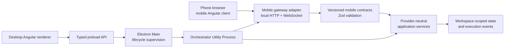

# Mobile companion phase 1

## Status and decision scope

This document defines the implemented phase-1 architecture for mobile access to Symphony. Phase 1 is a local-only capability: Symphony Desktop packages the mobile web client, starts and supervises its local service, and makes it reachable only from the selected local network. No hosted mobile site, cloud relay, public ingress, or native mobile application is part of this phase.

The design keeps the client, contracts, and transport boundary separable so a later hosting decision does not require rebuilding the mobile user experience. No hosted transport, deployment, account system, or other phase-2 component should be implemented speculatively.

ADR-006 accepts a narrow, security-scoped exception to the repository's internal HTTP-server prohibition for this mobile companion only. The gateway remains an orchestrator-owned delivery adapter; it is not a general desktop API or cloud runtime.

## User outcome

An operator can enable **Mobile access** in Symphony Desktop, scan a QR code with a phone on the same local network, confirm the new device, and use a deliberately limited mobile view of Symphony. The operator does not configure a server, hostname, IP address, port, certificate, router, or firewall rule inside the product.

Symphony Desktop remains the authority for:

- enabling or disabling mobile access;
- starting, supervising, rebinding, and stopping the local service;
- generating and expiring pairing challenges;
- approving, listing, and revoking paired devices;
- authorizing every mobile read or command;
- selecting which provider-neutral data may leave the desktop process; and
- reporting actionable availability problems.

The phone is a companion surface, not a second control plane. It cannot access provider credentials, arbitrary files, worktrees, shell commands, generic IPC methods, or provider SDKs.

## Phase-1 product boundaries

### Included

- A responsive Angular mobile web client packaged with Symphony Desktop.
- Local HTTP and WebSocket delivery on one selected private network interface.
- A persisted **Mobile access** preference that is disabled by default.
- Automatic service start on later Symphony launches after the operator enables the capability once.
- A QR-code pairing flow with a short-lived, single-use challenge.
- Desktop confirmation before a new device receives access.
- Paired-device listing and immediate revocation.
- A mobile board projection that preserves the provider-neutral workflow stages as a vertical Mosaik expander group without reproducing the desktop FlowBoard layout.
- A complete ticket catalog for the authorized workspace scope, with ticket detail and the currently valid start or navigation action.
- Visibility into current and waiting executions, including bounded progress and selected control actions.
- A small, explicitly allowlisted mobile API for board, ticket, execution, and interaction use cases.
- Local lifecycle, diagnostics, packaging, and verification.

### Excluded

- External hosting, public DNS, public ingress, tunneling, relay, or cloud runtime.
- A native iOS or Android application.
- App Store or Play Store distribution.
- Router configuration, port forwarding, or access from outside the local network.
- A complete copy of the desktop renderer.
- Generic forwarding of the desktop preload API or orchestrator request surface.
- Mobile access to credentials, settings secrets, repository files, worktrees, terminals, or arbitrary commands.
- Speculative implementation of a future remote transport.

## User experience

### Activation model

The product uses capability language rather than infrastructure language. The UI says **Mobile access**, never **Start web server**.

The persisted preference and runtime state are separate:

| Preference or state | Meaning                                                                 | User-visible presentation                                |
| ------------------- | ----------------------------------------------------------------------- | -------------------------------------------------------- |
| Disabled            | The operator has not enabled mobile access. No network listener exists. | **Mobile access is off**                                 |
| Starting            | Symphony is selecting the local interface and starting the service.     | **Preparing mobile access…**                             |
| Available           | The service is reachable and pairing can begin.                         | **Ready on this Wi-Fi network**                          |
| Unavailable         | Symphony cannot provide access on the current network.                  | A specific cause and a relevant retry or settings action |

Enabling mobile access is an explicit user decision. Once enabled, Symphony starts it automatically with the supervised background service on subsequent launches. Disabling it closes the listener, invalidates live mobile sessions, and prevents automatic restart.

The service remains available while Symphony intentionally continues in background mode. It becomes unavailable when Symphony fully quits, the computer sleeps, or the selected network disappears. Resume and network-change handling re-evaluate the interface and restart the listener when the persisted preference remains enabled.

### Entry points

The implemented entry point is a **Mobile access** section in Settings. It enables or disables the capability, creates QR pairing challenges, approves new devices, and manages paired devices. A contextual **Open on phone** action may be added later without changing the gateway or pairing contract, but it is not part of the current POC surface.

### Pairing surface

When the service is available, Symphony Desktop presents:

- a QR code;
- the instruction **Connect your phone to the same Wi-Fi network and scan the code**;
- challenge expiry and regeneration when relevant;
- a copyable local address as an accessibility and camera-failure fallback; and
- an explicit statement that Symphony Desktop must remain running.

The local IP address and port may appear in the fallback address, but they are not configuration inputs. Normal use hides them behind the QR code.

After the phone opens the pairing page, Symphony Desktop displays the proposed device name and asks the operator to approve or reject it. Both devices display the same short verification code before approval. The phone retains its pending pairing context for the lifetime of the browser tab, so an iOS background transition or page reload while the operator approves on the Mac resumes the same request instead of losing the challenge. A successful pairing either opens the execution that initiated **Open on phone** or the mobile overview.

The phone pairing surface keeps the Symphony mark subordinate to the task at 36 px and applies at least 24 px of safe-area-aware inline spacing. Pairing progress and recovery use the public Mosaik Busy State, Message, Text, and Button APIs; the mark is not used as a hero image.

### Paired-device management

Settings lists a human-readable device label, pairing time, last connection time, and current connection state. The operator can revoke one device or all devices. Revocation terminates matching sessions and rejects subsequent requests without requiring a service restart.

## Mobile experience

The phase-1 client is a purpose-built responsive surface rather than the desktop renderer compressed onto a phone. Its initial information architecture is:

- **Board**: one vertically joined accordion row per workflow stage, in workflow order. Each header contains the stage name and ticket count; expanding it reveals that stage's ticket list. On a phone this is a list projection, not a horizontally compressed desktop board.
- **Tickets**: the complete provider-neutral ticket catalog for the authorized workspace scope, with search, current stage, active-execution state, and navigation to ticket detail.
- **Ticket detail**: title, description, workflow state, relevant metadata, the desktop's findings for the ticket, recent activity, and every step its stage currently offers. Those steps are not derived on the phone: the desktop resolves them from the same rule its board card menu uses (`resolveWorkItemActions` in `libs/domain`) and sends them with the ticket, so both surfaces always offer the same work - an analysis or re-analysis, an implementation or a rework, the pull request a finished implementation has not published, the cancellation of a running step, and the decisions of a human gate. A step the desktop reports as blocked is shown with its reason and cannot be started. The rework is the one step the phone can start but the board card cannot: it needs a written description, and the phone has a place to write one. A ticket may also be moved one column forward or backward, or into any column of its own board; the desktop resolves which columns those are. Findings are read-only on mobile - their repairs write provider fields and stay with the desktop drawer, which shows the exact writes first. A GitHub-backed ticket also presents the allowlisted remote-comment commands and opens its public issue URL in GitHub. The current automation activation state is read-only on mobile; enabling it remains an explicit Symphony Desktop setting.
- **Processes**: current and waiting executions with their owning ticket, state, and bounded latest progress.
- **Connection**: connected desktop name, local-only limitation, reconnect state, and pairing status.

Board and ticket screens are read projections over the same provider-neutral workflow and work-item model used by the desktop application. Mobile interactions retain the exact workspace and work-item identifiers; an aggregate view never weakens workspace isolation. The board uses single expansion: opening one workflow stage closes the previously open stage. The expanded stage renders readable ticket rows, while collapsed headers retain the complete board overview through their labels and counts. The current stage selection may be retained locally as presentation state; it does not alter workflow data.

Every command the phone sends is re-checked against the ticket's current steps before it runs: a phone may hold a snapshot that is seconds old, and the stage may have moved on. A move is accepted only into a column of the board that owns the ticket.

The mobile projection exposes only a validated HTTP(S) ticket URL, a provider-neutral remote-command capability flag, and the boolean automation activation state. A malformed ticket URL is omitted together with the action that depends on it, and a merge request without a valid public URL is excluded; neither can invalidate the remaining mobile snapshot. It does not expose GitHub credentials, comments, provider payloads, settings mutation, or generic navigation. A public issue link may hand off to the GitHub mobile app through the operating system's normal universal-link behavior; Symphony does not embed or impersonate GitHub.

The supplied GitHub mobile board is a composition reference, not a source for GitHub-specific product behavior. The Symphony projection classifies the visible decisions as follows:

| Decision                                               | Classification | Symphony treatment                                                                                                     |
| ------------------------------------------------------ | -------------- | ---------------------------------------------------------------------------------------------------------------------- |
| Workflow columns become a vertical accordion           | Adopt          | Preserve workflow order, counts, and single expansion.                                                                 |
| Expanded column contains a scannable ticket sequence   | Adopt          | Keep ticket title and number visually primary, followed by only decision-relevant metadata and a row divider.          |
| Compact metadata appears on a subordinate surface      | Adapt          | Use provider-neutral workflow, execution, workspace, assignee, and label data only when it helps the next user action. |
| Main navigation floats above the lower viewport edge   | Adopt          | Render the registered Mosaik tab strip as an absolute overlay owned by `MobilePresenterView`.                          |
| Selected tab has stronger surface and accent treatment | Adapt          | Use the scoped Symphony Mosaik theme and component tokens rather than GitHub colors.                                   |
| GitHub board warning, share action, and search action  | Differ         | Do not copy them by default; each element must pass the UI relevance gate for the current Symphony route.              |

### Mosaik board composition

Mosaik 0.1.96 provides the standalone Angular `ExpanderComponent` and `ExpanderGroupComponent`. The mobile board adopts those components rather than introducing a Symphony-owned accordion primitive:

- one `mosaik-expander-group` for the board;
- `mode="single"` so at most one workflow stage is expanded;
- `stacking="joined"` so the stages read as one continuous mobile list;
- one `mosaik-expander` per provider-neutral workflow stage;
- stage name in the expander header and ticket count in the header action or equivalent accessible label; and
- ticket rows inside the expanded content, with navigation to ticket detail and an active-process indication only when it changes the available action.

The Mosaik reference implementation supplies expansion state, collapse/expand/toggle behavior, keyboard navigation, expanded/collapsed events, focus treatment, caret placement, animation, and theme tokens. Implementation should preserve that behavior and avoid rebuilding it with product-owned CSS or generic `<details>` elements.

The joined expander headers span the content width and visually read as the mobile replacement for FlowBoard columns. A header keeps the stage label on the leading side and groups the count plus the Mosaik caret on the trailing side. The expanded content follows the reference hierarchy without cloning its provider-specific fields: ticket state icon, title and short identifier form the primary line; optional decision-relevant facts form a compact secondary surface; relative activity and a divider separate tickets. Empty stages retain their header and count, and their expanded state uses a Mosaik empty-state treatment instead of disappearing.

The page header may expose the current board or workspace and a back action when route context requires them. Search, filtering, sharing, connection status, and explanatory copy appear only when they support an immediate decision or recovery action. In particular, Symphony does not reproduce the reference message that the board layout is unsupported, because the accordion is the supported mobile board layout.

## Angular application and presentation architecture

The mobile client is a separate, independently buildable Nx Angular application. It is not a route inside the Electron renderer and it does not import from `apps/renderer`. The application root is `apps/mobile`; that application owns only browser bootstrap and composition concerns:

- `main.ts` and the router-only mobile shell root;
- `MobileShellConfig` with the mobile route tree and the minimum Mosaik providers;
- mobile theme and icon registration;
- the local mobile transport adapter bootstrap; and
- build, serve, typecheck, lint, test, and packaged-asset targets.

The feature views do not live in the application folder. They remain in their owning existing frontend libraries so both browser surfaces use the same domain projections, presentation conventions, and product components:

```text
apps/
  renderer/                         desktop Angular composition root
  mobile/                           local mobile Angular composition root

libs/frontend/
  core/                             ViewPresenter, typed desktop client and presentation primitives
  presentation/                     desktop and mobile presenter shells, process/pairing surfaces
  features/work/                    desktop FlowBoard plus mobile board/tickets/ticket detail
  features/delivery/                desktop and mobile pull-request surfaces
  features/mobile/                  desktop access/pairing plus the browser transport/state/theme
  setting/                          generic desktop settings host and feature slots
  ui/                               product UI only where Mosaik has no suitable primitive
```

This is shared-library ownership, not a requirement to force one template onto incompatible form factors. The desktop board remains a Mosaik FlowBoard; the mobile board is a Mosaik expander list. They share provider-neutral board projections and presenter logic where behavior is identical, while each surface owns the composition needed for its viewport.

### Presenter pattern

Every routed mobile view follows the same presenter architecture as the desktop target:

- the Angular view is standalone and uses `ChangeDetectionStrategy.OnPush`;
- the view extends or composes the shared `PresenterView<TPresenter>` lifecycle;
- its presenter extends `ViewPresenter`, owns signals and derived presentation state, and performs named user intents;
- the view renders Mosaik components and forwards events without application policy;
- routing, drawers, sheets, and other surface-specific navigation remain outside shared board calculations; and
- stable `test-id` attributes identify mobile navigation, ticket rows, process rows, pairing, and consequential actions.

The current desktop `BoardViewPresenter` mixes reusable board calculations with desktop `DrawerService` navigation. Sharing it safely requires extracting the provider-neutral board/ticket projection and state-valid action calculation from drawer-specific coordination. The desktop presenter can retain drawer behavior; the mobile presenter navigates to mobile ticket and process routes. Neither duplicates workflow policy.

### Transport-neutral frontend core

The desktop and mobile clients use distinct injected, typed contracts. Desktop feature ports consume Core's `ORCHESTRATION_CLIENT`, backed by the validated preload API. The browser entry of the Mobile feature owns `MOBILE_COMPANION_CLIENT`, `BrowserMobileCompanionClient`, its session store and theme lifecycle. Mobile presenters consume the deliberately smaller mobile protocol; they never construct desktop Bootstrap, desktop snapshot synchronization or the retired aggregate facade.

```text
Desktop feature ports               Mobile feature presenters
          │                                    │
          ▼                                    ▼
ORCHESTRATION_CLIENT                MOBILE_COMPANION_CLIENT
          │                                    │
          ▼                                    ▼
window.orchestration                BrowserMobileCompanionClient
validated preload                   versioned same-origin HTTP/WebSocket
```

Both paths expose named operations and validated event projections. Their shared Domain models and ViewPresenter primitives do not unify their transport permissions. The mobile adapter cannot gain access to desktop-only settings, credentials, filesystem operations, or generic IPC. Shared presenters consume only the contract explicitly supported by their surface.

### Mobile shell and navigation

The mobile route layout is a dedicated `MobilePresenterView` in `libs/frontend/presentation`. It composes:

- a semantic application surface owned by the presenter shell;
- one Angular `router-outlet` for lazy feature pages; and
- `mosaik-tab-strip` with `mosaik-tab-strip-item` as the persistent main navigation.

The shell deliberately does not use `mosaik-app`. The mobile route container predates the 0.1.96 package migration and remains intentionally smaller than the desktop application shell. Routed content continues to use Mosaik Page, PageHeader, and PageContent; adopting the application container requires a separate renderer-parity review.

The main tab strip contains **Board**, **Tickets**, **Processes**, and **Connection**, but `MobilePresenterView` does not own that list as a hard-coded array. Each owning feature registers its immutable navigation descriptor through the shared frontend-core navigation registry. The target follows the proven FLAMOX365 `withNavigationItems` and `NavigationManager2` pattern: multi-provider registration, stable key, localized label, Mosaik icon, order, region, and typed route handle. Mobile items use a dedicated `mobile-main` region so a feature can contribute to desktop and mobile presentation deliberately without coupling either shell to the other's layout.

`MobilePresenterViewPresenter` consumes the registered `mobile-main` items as a sorted signal, executes their route handles, and derives selection from the Angular Router. Route state remains authoritative; the tab strip must not maintain a competing navigation state. Feature activation or authorization guards may filter registered items, but route guards still protect direct navigation. `mosaik-tab-panel` is not used for the shell because the tabs navigate lazy routes rather than keeping all pages mounted simultaneously.

The tab strip is an absolute overlay inside `MobilePresenterView`, not part of routed page content. The presenter shell owns its bottom and inline insets, stacking level, pointer-event boundary, and `env(safe-area-inset-bottom)` handling. The route scroll container reserves the measured navigation height plus safe-area and layout spacing as bottom padding, so the final ticket or action can scroll completely above the overlay. Individual pages must not compensate for the tab strip themselves.

The navigation surface is deliberately dark with light labels and icons in both application theme modes. It is implemented as a local, non-global variable island on the Mosaik tab strip. The shell scopes the public TabStrip and Memphis color variables, selection treatment, elevation, and safe-area geometry without changing the routed page theme. GitHub product colors are not copied.

Each route uses the standard Mosaik page composition:

```html
<mosaik-page>
  <mosaik-page-header>...</mosaik-page-header>
  <mosaik-page-pre-content>...</mosaik-page-pre-content>
  <mosaik-page-content>...</mosaik-page-content>
</mosaik-page>
```

`mosaik-page-pre-content` is included only when a page has relevant search, filtering, or an immediate contextual action. It is not used as decorative spacing.

The Page scroll-panel header groups `PageHeader` and `PagePreContent` as one sticky surface. On Tickets, this keeps both the title and Mosaik SearchBox visible while the catalog scrolls. The route scroll container remains the only vertical scroll owner, and the persistent tab strip stays absolutely positioned in the presenter shell.

The mobile client follows the phone's `prefers-color-scheme` setting before Angular bootstrap and updates when that preference changes. Memphis is the single application theme; routed surfaces and product-owned layout CSS consume semantic `--mosaik-scheme-*` and `--mosaik-font-family` tokens instead of light-only fallback colors. The bottom navigation remains an intentionally scoped dark Mosaik variable island in either mode.

### Mosaik component inventory

The phase-1 mobile UI should be assembled from the following existing Mosaik 0.1.96 Angular components:

| Surface                | Mosaik components                                                                                             | Intended use                                                                                         |
| ---------------------- | ------------------------------------------------------------------------------------------------------------- | ---------------------------------------------------------------------------------------------------- |
| Application shell      | `TabStripComponent`, `TabStripItemComponent`                                                                  | Presenter-owned mobile frame, scoped dark navigation island, and registered router-backed navigation |
| All routed pages       | `PageComponent`, `PageHeaderComponent`, `PageContentComponent`, optional `PagePreContentComponent`            | Consistent page hierarchy and insets                                                                 |
| Board                  | `ExpanderGroupComponent`, `ExpanderComponent`, `ListComponent`, `ListItemComponent`                           | One joined, single-expansion workflow accordion with ticket rows                                     |
| Tickets                | `SearchBoxComponent`, `ListComponent`, `ListItemComponent`, `BadgeComponent`                                  | Searchable complete ticket list and concise state                                                    |
| Ticket detail          | `StackComponent`, `CellGroupComponent`, `CellComponent`, `TextComponent`, `ButtonComponent`, `BadgeComponent` | Ticket facts, readable content, and the one state-valid primary action                               |
| Processes              | `ListComponent`, `ListItemComponent`, `ProgressRingComponent`, `TextComponent`, `ButtonComponent`             | Current/waiting process overview, progress, navigation, and safe controls                            |
| Pairing and connection | `QRCodeComponent`, `BusyStateComponent`, `MessageComponent`, `TextComponent`, `ButtonComponent`               | QR pairing, waiting/connected states, retry, and actionable unavailability                           |

Badges and progress indicators appear only when they change a decision or available action. Pages, headers, content, navigation, lists, accordion behavior, inputs, buttons, focus, and theme treatment come from Mosaik rather than Symphony-owned substitutes.

The component inventory was cross-checked against the installed `@pixel-brewery/mosaik-elements-angular` 0.1.96 public API and the Mosaik companion repository.

The first implementation exposes only capabilities backed by named application operations. Its contract surface includes a board snapshot, paginated ticket catalog, ticket detail, current executions, bounded event subscription, execution detail, and the state-valid Analyzer, Solver, resume, open-execution, or confirmed-cancellation command. Answers to agent questions or approval decisions join the allowlist only after the application layer owns explicit typed use cases for them.

Every consequential mobile action requires a confirmation appropriate to its effect. The UI must make a lost desktop connection distinct from a failed execution.

## Runtime architecture



The mobile gateway runs in the Orchestrator Utility Process or in a separately supervised utility process owned by the same application boundary. It must not run in the sandboxed renderer, expose Electron Main as an application server, or move orchestration policy into Electron Main.

Electron Main remains responsible for desktop lifecycle and Utility Process supervision. The orchestrator owns mobile authorization, application dispatch, provider-neutral projections, and persistence. Starting and stopping mobile access crosses the existing typed Renderer → Preload → Main → Utility Process path.

### Proposed component ownership

| Component             | Responsibility                                                                                       |
| --------------------- | ---------------------------------------------------------------------------------------------------- |
| Mobile web client     | Responsive presentation, explicit user intent, and validated mobile DTO consumption                  |
| Mobile contracts      | Versioned request, response, event, error, and session schemas                                       |
| Mobile access service | Capability state machine, authorization policy, workspace scope, and use-case dispatch               |
| Pairing service       | Challenge generation, expiry, verification, device registration, and revocation                      |
| Local gateway adapter | Static asset delivery, HTTP/WebSocket framing, origin checks, connection bounds, and network binding |
| Electron Main         | Supervision and operating-system lifecycle signals, without mobile application policy                |
| Desktop presenter     | User-facing enablement, pairing, availability, and device-management presentation                    |

The mobile client should be an independently buildable Angular application with no Electron or Node.js imports. It may reuse provider-neutral presentation models, Mosaik components, tokens, and responsive primitives where their browser packaging permits this without coupling it to the desktop shell.

## Local networking

The gateway must not default to unrestricted public-interface binding. It deterministically selects one physical IPv4 private local-network interface, prefers the primary Wi-Fi or Ethernet interface, ignores tunnel, VPN, container, bridge, and virtual-machine adapters, binds only to the selected address, and accepts only local peers allowed by its network policy. If no physical private interface remains, mobile access becomes unavailable with an actionable network message instead of binding to a tunnel or unrestricted address. This selection remains automatic; the operator does not configure an interface.

The local service:

- chooses a port from a bounded configured range;
- publishes the resolved address only inside the pairing surface;
- regenerates the address and QR challenge after a network change;
- does not use port forwarding or UPnP;
- does not advertise a public endpoint;
- has no runtime dependency on internet availability; and
- closes its listeners when mobile access is disabled or Symphony fully exits.

mDNS may later provide a friendly local name, but phase 1 must not depend on mDNS because router, phone, and operating-system support varies. The QR code remains authoritative.

## Pairing and session model

Pairing is a protocol, not merely an encoded URL.

1. The desktop requests a new challenge from the pairing service.
2. The service creates a random, single-use challenge with a short expiry.
3. The QR code encodes the current local origin, a pairing route, and challenge material. Secret challenge material belongs in the URL fragment where possible so it is not included in HTTP request targets or access logs.
4. The phone submits a device-generated key and proves possession of the challenge.
5. Desktop and phone display the same derived short verification code.
6. The desktop operator explicitly approves the proposed device.
7. The pairing service stores only the minimum device identity and revocation material required to authenticate later sessions.
8. Repeating the proposal from the same browser tab and device resumes the existing request until approval, rejection, or expiry; the challenge cannot be reassigned to another device name.
9. The challenge is invalidated when pairing is rejected or expires and becomes usable only through the approved device session after approval.

Session credentials are device-specific, scoped to the mobile API, rotatable, and revocable. They never authorize desktop IPC, provider APIs, generic application dispatch, or filesystem access. Session and pairing secrets must not appear in renderer state snapshots, URLs copied to diagnostics, logs, IPC errors, analytics, or persisted plaintext.

Pairing proves possession of the QR challenge and desktop approval; it does not by itself establish a real-world user identity. The product copy must not imply otherwise.

## API and data boundary

Mobile traffic uses a dedicated contract family rather than forwarding `window.orchestration` or accepting arbitrary method names. Each operation has its own Zod request and response schema, authorization rule, workspace scope, output bound, and explicit error union.

The mobile projection is intentionally smaller than the desktop state. It may contain:

- provider-neutral workspace and execution identifiers;
- user-visible workspace labels needed to distinguish authorized workspaces;
- provider-neutral workflow stages, board counts, work-item identifiers, titles, classifications, and current state;
- the state-valid action projection for each visible work item;
- execution state and bounded progress messages;
- explicit pending-interaction DTOs; and
- the exact named actions currently available to the device.

It must not contain credentials, credential references, environment variables, absolute paths, repository contents, raw provider payloads, raw Codex JSONL, shell details, internal IPC envelopes, or error stacks.

Commands are idempotent where practical, carry correlation identifiers, validate the current execution state, and return explicit stale-state or no-longer-authorized errors. WebSocket events are bounded projections; clients recover from gaps by requesting a new snapshot rather than assuming an unbroken stream.

## Security posture and PoC limitation

Same-Wi-Fi access is a reachability constraint, not a complete security boundary. A browser does not automatically trust a certificate generated by a local desktop application, while plain local HTTP cannot guarantee confidentiality or server authenticity against an active network attacker.

Phase 1 therefore requires an explicit security gate before implementation selects its transport posture:

- A development-only PoC may use HTTP on a declared trusted test network, expose only synthetic or non-sensitive data, and clearly document that it is not production-safe.
- A user-data PoC must add an approved local trust mechanism or an application-layer pairing and encryption design with its residual browser-bootstrap risk documented and accepted.

A QR challenge and device authorization prevent casual unauthorized use but do not, by themselves, make plaintext HTTP confidential. This limitation must not be hidden behind product copy.

Independent of the selected PoC transport, the gateway enforces request-size limits, connection limits, timeouts, origin validation, replay protection, challenge attempt limits, event bounds, structured redacted audit events, and fail-closed schema validation. Static assets use a self-only script policy and a self base URI; the production build emits a normal external stylesheet link so strict CSP never depends on an inline load handler. Response-validation failures log only the request route plus Zod issue codes and paths, never projected values, cookies, or pairing material. Mobile access is disabled by default.

## Lifecycle and recovery

The mobile access service uses explicit transitions rather than inferring availability from process existence:

```text
disabled → starting → available
             ↓           ↓
          unavailable ← rebinding
available → stopping → disabled
```

Unexpected listener failure triggers bounded restart with backoff. Repeated failure ends in `unavailable` and reports one actionable cause to the desktop presenter. It must not create a generic health badge elsewhere in the workspace.

Network changes invalidate outstanding pairing challenges and live origins. Existing device authorization remains persisted, but devices reconnect only through the newly resolved local origin. Sleep, resume, background continuation, Utility Process restart, and full application quit integrate with the existing desktop lifecycle rather than creating an independent daemon.

## Packaging and configuration

The mobile client is built as its own Nx application and packaged as immutable assets inside the Symphony desktop distribution. Its application-owned Tailwind v4/PostCSS entry compiles the layout utilities used by mobile templates and shared browser-safe views into those assets. Production style optimization keeps minification enabled but disables critical-CSS inlining, because Angular's lazy stylesheet activation otherwise requires an inline `onload` handler that the gateway correctly blocks. The gateway serves only that known asset root and has no general filesystem-serving capability.

Versioned configuration should cover only phase-1 policy, for example:

- `enabled`;
- selected or automatic local interface policy;
- bounded port-range policy; and
- paired-device records or references to protected records.

There is no hosted base URL in phase-1 configuration. The client receives its local API origin from same-origin bootstrap data and uses relative asset paths. Keeping build output, contracts, and transport access behind explicit client interfaces is sufficient preparation for a possible later hosting decision.

## Verification strategy

Implementation is not complete until the following evidence exists:

- unit tests for the capability state machine, challenge expiry, one-time use, revocation, authorization, and explicit errors;
- contract tests that reject unknown methods, malformed payloads, oversized data, stale commands, and provider-specific leakage;
- projection tests proving that board counts, the ticket catalog, ticket detail, and active executions retain exact workspace and work-item ownership;
- application tests proving that a mobile start command uses the same state-valid named Analyzer or Solver use case as the desktop renderer;
- integration tests for static delivery, same-origin API access, WebSocket recovery, interface binding, shutdown, and bounded restart;
- a packaged-process Playwright test that enables mobile access through the renderer, opens the generated pairing address in a separate 393 × 852 browser context, verifies the compact mark and safe-area spacing, approves the matching verification code on the desktop, and requires a successful mobile snapshot before the overview appears;
- presenter tests proving that feature registrations determine tab order, authorization filtering, route selection, and navigation without a hard-coded shell list;
- mobile viewport tests proving that the absolute tab strip honors the bottom safe area and never obscures the final board ticket or page action;
- real-device checks on supported macOS and Windows network/firewall configurations;
- sleep, resume, network-change, background-mode, Utility Process restart, and full-quit tests;
- evidence that the packaged mobile client works without internet access; and
- an affected-tree naming audit using `Symphony` consistently in all human-readable copy.

The packaging smoke test must verify that the mobile asset bundle is present and that no development server or source directory is required at runtime.

## Phase-1 acceptance criteria

1. Mobile access is disabled by default and creates no listener while disabled.
2. The operator enables **Mobile access** without seeing or configuring server infrastructure.
3. Symphony starts and supervises the local service and reports **Ready on this Wi-Fi network**.
4. A phone on the selected local network opens the packaged client by scanning the QR code without internet access.
5. A short-lived challenge, matching verification code, and desktop approval are required before data is returned.
6. An unauthorized, expired, replayed, revoked, malformed, or out-of-scope request fails closed.
7. The paired phone shows every authorized workflow stage as a joined Mosaik accordion row with its ticket count, allows one stage to be expanded at a time, and renders readable ticket rows inside it.
8. Board ticket rows use the reference hierarchy but expose only provider-neutral, decision-relevant metadata and no unsupported-layout filler message.
9. The absolute, safe-area-aware Mosaik tab strip remains dark with light content, is populated by feature registrations, reflects the active route, and never obscures the last scrollable item.
10. The paired phone can browse the complete authorized ticket catalog and open a ticket without losing its exact workspace identity.
11. Ticket detail exposes only the action valid in the current application state, and starting work creates the same typed Analyzer or Solver operation used by the desktop renderer.
12. Current and waiting executions remain visible with bounded progress and a link back to their owning tickets.
13. The paired phone receives only the allowlisted provider-neutral projection and actions.
14. Disabling mobile access immediately closes listeners and invalidates active sessions.
15. Re-enabling the persisted capability after a normal Symphony restart requires no server configuration from the operator.
16. Full application quit makes the mobile client unavailable; deliberate Symphony background continuation keeps it available.
17. The complete flow works on a private local network without public DNS, external hosting, cloud services, or a native mobile installation.

## Decisions required before implementation

The following decisions must be resolved in an accepted ADR or change request before production code is added:

1. Approve the narrow exception to the repository's internal-HTTP-server prohibition.
2. Select and document the PoC transport-security posture and data sensitivity limit.
3. Confirm whether device authorization persists across desktop restarts in the first increment.
4. Confirm pagination, search, and workspace-view behavior for the complete ticket catalog.
5. Confirm supported desktop operating systems and real-device/browser test matrix.

## Shared employee figures (2026-10-06)

The bounded mobile snapshot includes employee ID, display name, persisted appearance,
actual activity, related ticket IDs and last-known time. It excludes CLI accounts,
routes, credentials and settings. Mobile uses the same locally packaged PNGs and
shared Symphony `AgentFigureComponent` as Desktop, including offscreen and reduced-motion
handling. The desktop employee editor owns appearance changes; the phone remains
a scoped companion. The Memphis theme and locally packaged Space Grotesk fonts
are shared with Desktop. See [production orbit](production-orbit.md).
