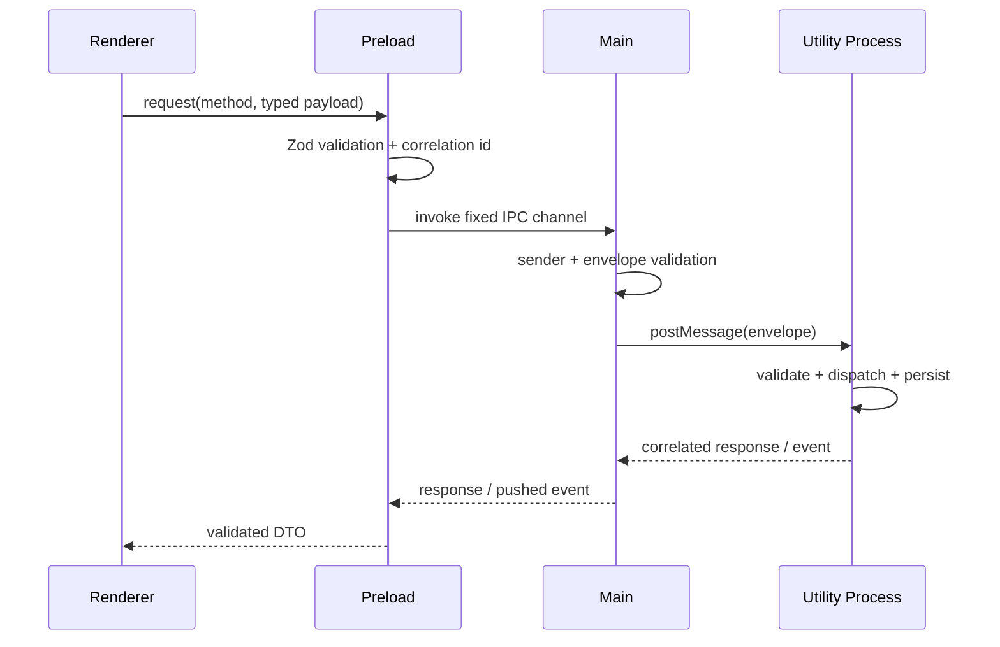

# Process model

The renderer has the smallest authority: it displays state and requests named operations. Its BrowserWindow enables sandboxing and context isolation, disables Node integration, and receives only `window.orchestration`. Preload validates and unwraps messages. Main owns lifecycle, origin checks, correlation, timeout handling, and Utility Process supervision but no workflow logic. The Utility Process owns orchestration, SQLite, and command diagnostics.

Main terminates the child during application shutdown and rejects outstanding calls if it exits. A production supervisor will add bounded restart/backoff and an explicit degraded-state event; that work remains on the roadmap.
