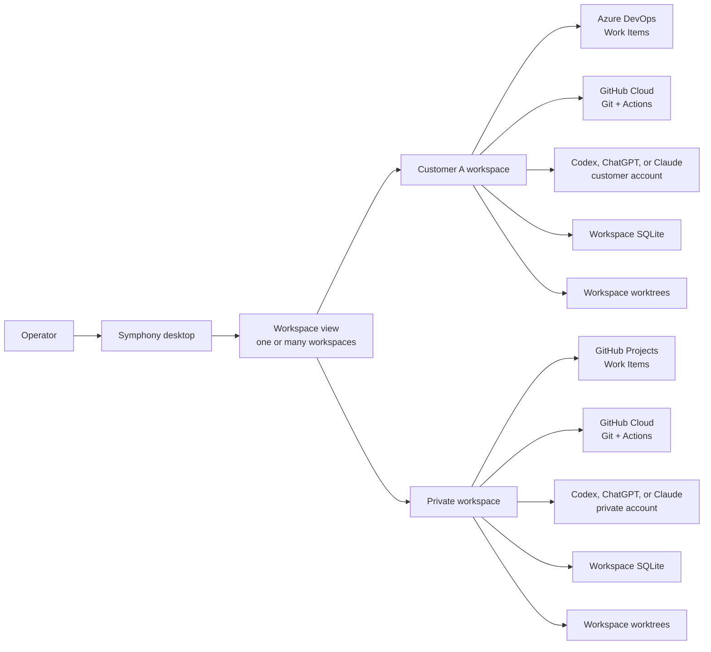

# System context

Symphony is a local desktop control plane for work that spans unrelated repositories, provider accounts, and technologies. A **Workspace** is the hard ownership and isolation boundary. A selected **Workspace View** may aggregate several workspaces for display, but it never merges credentials, persistence, worktrees, or execution identity.

Provider axes are independent:

1. Work tracking: Azure DevOps and GitHub Projects behind `WorkTrackingPort`.
2. Source control: GitHub Cloud today, independent of work tracking.
3. Continuous integration: GitHub Actions today, independently bound to repositories.
4. AI runtime: Codex/ChatGPT and Claude, with multiple workspace-owned accounts.
5. Repository/workspace execution: local Git checkout plus execution-owned worktrees.

The original four-way split is therefore directionally correct, but incomplete. Work tracking, source control, CI, and AI are the four external provider families; Git workspace execution is a fifth replaceable capability. Three cross-cutting dimensions must remain explicit rather than becoming another generic provider: account/credential identity, tenant persistence and filesystem isolation, and presentation scope. A Workspace View may combine display data, but those three dimensions never combine authority.

A `DeliveryContext` explicitly composes one workspace's work-item sources, repository bindings, CI bindings, and agent profile. Every execution persists an immutable binding snapshot. Changing the current board view or settings therefore cannot move an active execution to another account or customer.

Automatic execution remains off by default. Source changes happen only in an execution-owned worktree; work-item and CI mutations require named typed operations.
