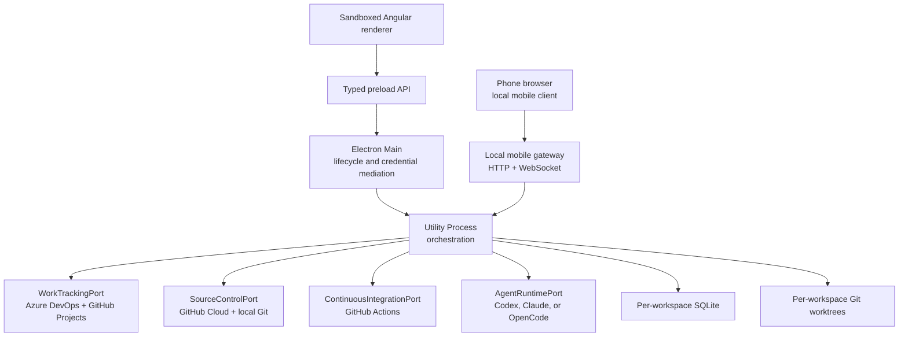

# System overview

Domain and application libraries are provider-neutral. Provider adapters, Git operations, orchestration, settings, and SQLite run only in the Utility Process. Electron Main verifies the sender, validates method-specific IPC, supervises the Utility Process, opens native file selection, and mediates credential-bearing login flows. The renderer never receives a filesystem primitive, shell primitive, token, or generic request escape hatch.

When the operator enables Mobile access, the Utility Process also owns the narrowly scoped local mobile gateway. Electron Main supplies only the packaged mobile asset location and supervises the process lifecycle. The gateway binds one private network interface, projects an allowlisted mobile contract from application services, and serves the separately built Angular client. It does not expose desktop IPC, provider APIs, credentials, files, or a generic orchestration bridge.

Workspace isolation is data- and identity-based inside the single supervised orchestration process: separate SQLite files, runtime homes, credential references, repository bindings, and worktree roots. Every invocation uses the immutable workspace binding of the concrete execution rather than mutable UI focus.

Execution use cases live in `libs/application/features/execution`. `AnalyzerService` delegates to focused lifecycle, admission, goal, delivery-group, workspace, start, manual-run, agent-run, claim, publication, workflow and event owners. Lifecycle alone owns live task controllers and pause intents; Admission alone owns start reservations and queue-drain coordination; Publication alone owns the guard against concurrent pull-request publication. Goal and delivery-group services own their durable transitions through the existing repositories. Collaborators exchange narrow capabilities through one composition factory, retaining a single owner for each session state and the established recovery, claim and side-effect order.

`OrchestrationSnapshotService` in `apps/orchestrator/src/snapshot` assembles the desktop projection from the feature read models, the execution state, workflow readiness, the catalog and local CI state. Execution publishes the pure Domain `IExecutionStateProjection` and consumes operational Work Item reads, detail reads and confirmed mutation feedback. Snapshot refresh explicitly reconciles delivery-group drift before refreshing relationship proposals.
