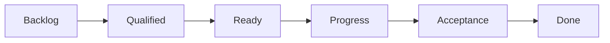

# FLAMOX365 – Empfohlener Gesamtworkflow für KI-gestützte Ticketbearbeitung

**Dokumenttyp:** Technische und prozessuale Gesamtspezifikation  
**Version:** 1.0  
**Stand:** 18.08.2026  
**Status:** Empfohlenes Zielmodell  
**Gültige Board-Struktur:** `Backlog → Qualified → Ready → Progress → Acceptance → Done`

> **Grundregel:** Vorwärts wird ausschließlich bei nachgewiesenem Erfolg gegangen. Rückwärts wird zum Owner der tatsächlichen Fehlerursache geroutet. Temporäre technische Fehler bleiben im aktuellen fachlichen Status und werden wiederholt. Nach wiederholtem Scheitern übernimmt ein Mensch.

---

## 1. Zweck dieses Dokuments

Dieses Dokument beschreibt den vollständigen empfohlenen FLAMOX365-Workflow für die KI-gestützte Erstellung, Analyse, Implementierung, Verifikation und menschliche Abnahme von GitHub-Issues.

Es definiert:

- die sechs sichtbaren Statusspalten im GitHub Project Board,
- die fünf beteiligten Skills beziehungsweise Prozessrollen,
- die beiden zwingenden menschlichen Freigabepunkte,
- den vollständigen Vorwärtsprozess,
- sämtliche Rückführungs-, Wiederholungs-, Blockierungs- und Eskalationswege,
- die technischen Zustände neben dem sichtbaren Board-Status,
- Claims, Leases, Heartbeats und Fencing Tokens,
- Idempotenz, Revisionierung und Rückverfolgbarkeit,
- Transition Guards für jeden Statuswechsel,
- Pull-Request-, CI-, Verify-, Merge- und Post-Merge-Regeln,
- Security-, Governance- und Audit-Anforderungen,
- Loop-Limits, Benachrichtigungen und menschliche Eskalationen,
- verbindliche Prozessinvarianten.

Ziel ist nicht die unrealistische Behauptung, dass niemals ein Fehler auftreten kann. Ziel ist vielmehr:

> **Kein Fehler darf unbemerkt bleiben, kein Ticket darf in einen undefinierten Zustand geraten, kein Skill darf unzulässige Übergänge auslösen und jeder Ausgang muss einen eindeutigen, reproduzierbaren Folgeschritt besitzen.**

---

## 2. Visuelle Gesamtübersicht



Die Übersicht zeigt die reguläre Vorwärtsfolge. Die verbindlichen Übergangsregeln und Rückführungen stehen in diesem Dokument.

---

## 3. Kernarchitektur

Der Prozess besteht aus drei voneinander getrennten Ebenen:

1. **GitHub Project Board**  
   Menschlich sichtbare Statusdarstellung mit exakt sechs Spalten.

2. **Skills und Human Gates**  
   Ausführende Rollen, die fachliche oder technische Arbeit leisten beziehungsweise Entscheidungen treffen.

3. **Technischer Workflow-State**  
   Maschinenlesbare Prozesswahrheit mit Run-Status, Claim, Lease, Revisionen, Fehlerursache, Retry, Rework, Blockierung und Audit-Daten.

Das Board allein darf **nicht** die einzige Workflow-Datenbank sein. Ein Ticket kann beispielsweise sichtbar in `Progress` stehen, während es technisch einen der folgenden Zustände besitzt:

- `claimed`
- `running`
- `retry_wait`
- `blocked`
- `human_required`
- `quarantined`
- `verification_running`
- `merge_pending`

Der Board-Status bleibt bewusst einfach und für Menschen verständlich. Die technische Detailsteuerung erfolgt orthogonal dazu.

---

## 4. Unveränderliche Board-Struktur

Die sichtbaren GitHub-Project-Spalten bleiben:

```text
Backlog → Qualified → Ready → Progress → Acceptance → Done
```

Es werden für Retry, Blocked, Failed oder Human Required **keine zusätzlichen Board-Spalten** benötigt. Diese Zustände werden über technische Workflow-Felder abgebildet.

| Board-Status   | Verbindliche Bedeutung                                                           | Verantwortliche Rolle | Eintritt                                     | Regulärer Austritt              |
| -------------- | -------------------------------------------------------------------------------- | --------------------- | -------------------------------------------- | ------------------------------- |
| **Backlog**    | KI-erzeugtes oder fachlich zurückgeführtes Ticket wartet auf menschliche Prüfung | Mensch                | Create erstellt Ticket oder Requirement Loop | Human Gate 1                    |
| **Qualified**  | Fachlich geprüft und für technische Analyse freigegeben                          | Analyze Skill         | Human Gate 1 genehmigt oder Re-Analysis Loop | Analyze `PASS`                  |
| **Ready**      | Vollständig analysiert, revisionsgültig und grundsätzlich implementierbar        | Supervisor/Scheduler  | Analyze `PASS`                               | erfolgreicher Claim durch Solve |
| **Progress**   | Exklusiv geclaimt; Implementierung, PR, CI und Verify laufen                     | Solve und Verify      | atomarer Claim                               | Verify `PASS`                   |
| **Acceptance** | Technisch unabhängig verifiziert; wartet auf menschliche Abnahme                 | Mensch                | Verify `PASS`                                | Human Gate 2                    |
| **Done**       | Fachlich akzeptiert, korrekt gemerged und auditiert                              | Mensch + Supervisor   | Human Gate 2 und alle Abschluss-Guards       | Endzustand                      |

---

## 5. Die fünf Prozessrollen

### 5.1 Create Skill

Der Create Skill erzeugt aus einer menschlichen Eingabe ein strukturiertes GitHub-Issue und legt es in `Backlog` ab.

#### Aufgaben

- fachliche Eingabe strukturieren,
- aussagekräftigen Titel erzeugen,
- Problem und Zielzustand beschreiben,
- Akzeptanzkriterien formulieren,
- bekannte Randbedingungen dokumentieren,
- relevante Screenshots oder Anhänge verknüpfen,
- Metadaten und Labels vorbelegen,
- offensichtliche Unvollständigkeiten kennzeichnen,
- Issue im Backlog erzeugen.

#### Darf nicht

- `Backlog → Qualified` auslösen,
- menschliche Freigabe simulieren,
- technische Machbarkeit verbindlich bestätigen,
- Code implementieren,
- ein Ticket auf `Done` setzen.

#### Ergebnis

```text
GitHub-Issue erstellt
Board-Status = Backlog
Workflow-State = awaiting_human_review
```

---

### 5.2 Analyze Skill

Der Analyze Skill beobachtet `Qualified`-Tickets, claimt einen Analyse-Run und erstellt einen maschinenlesbaren technischen Umsetzungsplan.

#### Aufgaben

- fachliches Verständnis prüfen,
- technische Machbarkeit bewerten,
- betroffene Anwendungen, Module und Komponenten bestimmen,
- technische Abhängigkeiten ermitteln,
- mögliche Datenbank- und Migrationsänderungen erkennen,
- Risiken und Sicherheitsrelevanz klassifizieren,
- Implementierungsstrategie formulieren,
- Teststrategie definieren,
- Akzeptanzkriterien auf technische Maßnahmen abbilden,
- erwartete Change Surface und Konfliktrisiken bestimmen,
- offene Fragen und Blocker erkennen,
- Issue Revision Fingerprint erzeugen,
- Definition of Ready prüfen.

#### Darf nicht

- fachliche Anforderungen eigenmächtig verändern,
- offene Fragen erfinden oder stillschweigend beantworten,
- Human Gate 1 umgehen,
- Code implementieren,
- seine eigene Analyse durch eine Implementierung „beweisen“,
- `Acceptance` oder `Done` setzen.

#### Reguläres Ergebnis

```text
Analyze PASS
→ Supervisor prüft Guards
→ Board-Status = Ready
```

---

### 5.3 Solve Skill

Der Solve Skill implementiert ausschließlich auf Basis einer gültigen Analyse.

#### Aufgaben

- Ready-Ticket atomar claimen,
- Ticket unverzüglich nach `Progress` überführen,
- separaten Branch verwenden,
- gemäß Analyseplan implementieren,
- Unit-, Integrations- und erforderliche weitere Tests ergänzen,
- Commits revisionssicher erzeugen,
- Pull Request erstellen,
- technische Artefakte und Evidence hinterlegen,
- auf Verify-Ergebnisse reagieren,
- Implementierungsfehler innerhalb von `Progress` korrigieren.

#### Darf nicht

- seine eigene Arbeit abschließend verifizieren,
- Verify `PASS` setzen,
- Human Gate 2 umgehen,
- Anforderungen stillschweigend neu interpretieren,
- unzulässige Produktionszugriffe durchführen,
- `Done` ohne menschliche Akzeptanz auslösen.

---

### 5.4 Verify Skill

Der Verify Skill ist eine unabhängige technische Kontrollinstanz.

#### Aufgaben

- Verifikation gegen einen konkreten Commit-SHA,
- Akzeptanzkriterien gegen tatsächliches Verhalten prüfen,
- Analyseplan gegen tatsächlichen Diff prüfen,
- CI- und Testergebnisse prüfen,
- Regressionen erkennen,
- unerwartete Nebenänderungen identifizieren,
- Sicherheits-, Mandantentrennungs- und Qualitätsanforderungen prüfen,
- fehlende oder unzureichende Tests erkennen,
- Evidence für jedes Akzeptanzkriterium erzeugen,
- Fehlerursache klassifizieren.

#### Unabhängigkeit

Der Verify Skill:

- verwendet eine getrennte Skill-Rolle,
- besitzt eigene Berechtigungen,
- darf nicht vom Solve Skill auf `PASS` gesetzt werden,
- prüft nicht nur die von Solve selbst geschriebenen Tests,
- bindet jedes Ergebnis an einen unveränderlichen Commit-SHA.

#### Reguläres Ergebnis

```text
Verify PASS
→ Supervisor prüft Guards
→ Board-Status = Acceptance
```

---

### 5.5 Supervisor / Orchestrator

Der Supervisor ist der Workflow-Controller. Er erstellt weder Anforderungen noch Implementierungen.

#### Aufgaben

- Skills über Events und Reconciliation-Läufe steuern,
- atomare Claims und Leases verwalten,
- Heartbeats und Fencing Tokens kontrollieren,
- Statusübergänge anhand fester Guards ausführen,
- Skill-Ergebnisse routen,
- Abhängigkeiten und Zyklen erkennen,
- Priorisierung und Scheduling steuern,
- Retry- und Rework-Loops verwalten,
- Loop-Limits überwachen,
- Stale und Failed Runs erkennen,
- GitHub-Issue, Board, Branch, PR, Checks und internen State reconciliieren,
- Revisionen und Invalidierungen überwachen,
- menschliche Eskalationen auslösen,
- Benachrichtigungen, Audit und Metriken sicherstellen,
- unzulässige manuelle Zustände korrigieren oder eskalieren.

#### Darf nicht

- Human Gate 1 oder Human Gate 2 selbst entscheiden,
- fehlende fachliche Entscheidungen erfinden,
- Sicherheitsregeln zugunsten schnellerer Verarbeitung umgehen.

---

## 6. Berechtigungs- und Governance-Matrix

| Aktion                   | Create |         Analyze |          Solve |          Verify |                     Supervisor |           Mensch |
| ------------------------ | -----: | --------------: | -------------: | --------------: | -----------------------------: | ---------------: |
| Issue erstellen          |     Ja |            Nein |           Nein |            Nein |              technisch möglich |               Ja |
| Backlog setzen           |     Ja |            Nein |           Nein |            Nein |                             Ja |               Ja |
| Qualified genehmigen     |   Nein |            Nein |           Nein |            Nein |                           Nein |           **Ja** |
| Analyse erstellen        |   Nein |          **Ja** |           Nein |            Nein |                           Nein |         optional |
| Ready setzen             |   Nein | Ergebnis melden |           Nein |            Nein |            **Ja, nach Guards** |         optional |
| Implementieren           |   Nein |            Nein |         **Ja** |            Nein |                           Nein |         optional |
| Verify-Ergebnis erzeugen |   Nein |            Nein |           Nein |          **Ja** |                           Nein |         optional |
| Acceptance setzen        |   Nein |            Nein |           Nein | Ergebnis melden |            **Ja, nach Guards** |         optional |
| Fachlich akzeptieren     |   Nein |            Nein |           Nein |            Nein |                           Nein |           **Ja** |
| Merge auslösen           |   Nein |            Nein | PR vorbereiten |            Nein |            nach Human Approval |         optional |
| Done setzen              |   Nein |            Nein |           Nein |            Nein | nach Human Approval und Guards |   **Ja/Trigger** |
| Routing und Loops        |   Nein |      Empfehlung |     Empfehlung |      Empfehlung |                         **Ja** | Override möglich |
| Audit manipulieren       |   Nein |            Nein |           Nein |            Nein |                    append-only |             Nein |

> **Policy Enforcement ist zwingend stärker als Prompt-Instruktionen.** Verbotene Aktionen müssen durch Token, Rollen, Branch Protection und Workflow-Guards technisch ausgeschlossen werden.

---

## 7. Vollständiger Vorwärtsprozess

```mermaid
flowchart LR
    C[Create Skill] --> B[Backlog]
    B --> H1{Human Gate 1}
    H1 -->|Freigabe| Q[Qualified]
    Q --> A[Analyze Skill]
    A -->|PASS + Guards| R[Ready]
    R --> CL[Atomic Claim + Lease]
    CL --> P[Progress]
    P --> S[Solve Skill]
    S --> BR[Branch + Commits]
    BR --> PR[Pull Request]
    PR --> CI[CI / Build / Tests]
    CI --> V[Verify Skill]
    V -->|PASS + Guards| AC[Acceptance]
    AC --> H2{Human Gate 2}
    H2 -->|Akzeptiert| M[Merge]
    M --> PM[Post-Merge Checks]
    PM --> D[Done]
```



### 7.1 Backlog und Human Gate 1

Das Ticket wird nicht allein deshalb weiterverarbeitet, weil es formal vollständig aussieht. Ein autorisierter Mensch entscheidet:

| Entscheidung           | Folge                                             |
| ---------------------- | ------------------------------------------------- |
| Freigeben              | `Backlog → Qualified`                             |
| Rückfrage erforderlich | bleibt `Backlog`, Workflow-State `human_required` |
| Fachlich überarbeiten  | bleibt `Backlog`                                  |
| Duplikat               | schließen und Original verknüpfen                 |
| Ablehnen               | schließen als `not_planned`                       |
| Aufteilen              | verknüpfte Folgetickets erstellen                 |
| Zusammenführen         | Ursprungsbeziehungen dokumentieren                |
| Zurückstellen          | bleibt `Backlog`                                  |

### 7.2 Qualified und Analyze

Der Analyze Skill arbeitet im Status `Qualified`. Während der Analyse bleibt die Karte sichtbar in `Qualified`.

Ein Ticket darf nur nach `Ready`, wenn:

- technische Machbarkeit bestätigt,
- Akzeptanzkriterien technisch abgebildet,
- keine unbeantworteten Fragen,
- Risiken klassifiziert,
- Abhängigkeiten bekannt,
- Teststrategie vorhanden,
- Analyseartefakt vollständig,
- Issue Revision noch gültig.

### 7.3 Ready und Scheduling

`Ready` bedeutet:

> Das Ticket ist technisch vorbereitet, aber nicht zwingend sofort ausführbar.

Der Supervisor prüft vor dem Solve-Claim:

- offene Abhängigkeiten,
- verfügbare Worker,
- Priorität,
- WIP-Limit,
- Konflikte mit parallel laufenden Tickets,
- Gültigkeit der Analyse,
- Risiko- und Sicherheitsanforderungen,
- bestehende Claims.

### 7.4 Progress, Branch, PR und Verify

Nach erfolgreichem Claim wird das Ticket unmittelbar nach `Progress` verschoben.

Innerhalb von `Progress` findet der vollständige technische Unterprozess statt:

```text
Solve
→ Branch
→ Commits
→ Pull Request
→ CI / Build / Tests
→ Verify
```

Bei Verify `FAIL` bleibt das Ticket grundsätzlich in `Progress`, sofern der Fehler in der Implementierung liegt.

### 7.5 Acceptance und Human Gate 2

`Acceptance` bedeutet:

- Implementierung abgeschlossen,
- CI erfolgreich,
- Verify erfolgreich,
- Verify-Ergebnis gilt für aktuellen Commit,
- keine offenen technischen Findings,
- Preview/Staging ist verfügbar, sofern erforderlich.

Der Mensch entscheidet:

| Entscheidung                     | Folge                                                |
| -------------------------------- | ---------------------------------------------------- |
| Akzeptieren                      | Merge und Abschluss                                  |
| Implementierung falsch           | zurück zu `Progress`                                 |
| technische Konzeption falsch     | zurück zu `Qualified`                                |
| Anforderung muss geändert werden | zurück zu `Backlog`                                  |
| nicht mehr erforderlich          | schließen/archivieren                                |
| Rückfrage                        | `Acceptance` bleibt, Workflow-State `human_required` |

### 7.6 Done

`Done` wird erst gesetzt, wenn:

- Human Gate 2 positiv entschieden,
- richtige Revision akzeptiert,
- richtiger Pull Request gemerged,
- Zielbranch den erwarteten Commit enthält,
- verpflichtende Post-Merge-Checks erfolgreich,
- Audit vollständig,
- keine offene Blockierung oder Eskalation.

**Empfohlene Definition:** `Done` bedeutet „fachlich akzeptiert, in den Zielbranch gemerged und technisch abgeschlossen“. Produktion/Deployment kann als eigener Release-Prozess außerhalb dieses Boards geführt werden.

---

## 8. Definition of Ready

Analyze muss mindestens folgende Artefakte liefern:

```yaml
analysis:
  feasible: true
  issue_revision: 'sha256:...'
  problem_understanding: '...'
  affected_components:
    - frontend
    - api
  likely_change_surface:
    - apps/web/...
    - apps/api/...
  dependencies: []
  implementation_plan:
    - step: 1
      description: '...'
  database_migration:
    required: false
  risk:
    class: low
    reasons: []
  test_strategy:
    - unit
    - integration
  acceptance_mapping:
    AC-1:
      implementation_step: 2
      verification: 'integration test ...'
  unresolved_questions: []
  ready_for_solve: true
```

Ein Ticket ist **nicht Ready**, wenn mindestens einer der folgenden Punkte zutrifft:

- offene fachliche Frage,
- widersprüchliches Akzeptanzkriterium,
- unbekannte notwendige Abhängigkeit,
- nicht bewertetes Sicherheitsrisiko,
- fehlende Teststrategie,
- veraltete Issue Revision,
- technisch nicht umsetzbarer Plan,
- unklare Datenmigration,
- fehlendes Acceptance Mapping.

---

## 9. Transition Guards

Jeder Statuswechsel besitzt verbindliche technische Vorbedingungen.

### 9.1 Backlog → Qualified

```text
authorized_human_approval
AND mandatory_issue_fields_complete
AND no_open_required_question
AND not_duplicate
AND not_cancelled
```

### 9.2 Qualified → Ready

```text
analyze_outcome = PASS
AND analysis_complete
AND unresolved_questions = 0
AND feasible = true
AND issue_revision = analyzed_issue_revision
AND test_strategy_present
AND acceptance_mapping_complete
```

### 9.3 Ready → Progress

```text
atomic_claim_acquired
AND lease_active
AND fencing_token_current
AND analysis_revision_valid
AND dependencies_satisfied
AND no_hard_collision
AND worker_available
AND risk_policy_satisfied
```

### 9.4 Progress → Acceptance

```text
pull_request_exists
AND ci_passed
AND required_tests_passed
AND verify_outcome = PASS
AND verified_commit_sha = current_pr_head_sha
AND issue_revision_still_valid
AND no_open_findings
AND no_unresolved_security_gate
```

### 9.5 Acceptance → Done

```text
authorized_human_acceptance
AND accepted_commit_sha = current_pr_head_sha
AND merge_successful
AND target_branch_contains_expected_commit
AND required_post_merge_checks_passed
AND audit_complete
```

---

## 10. Standardisierte Skill-Ergebnisse

Jeder Skill liefert ein strukturiertes Ergebnis an den Supervisor. Der Skill verschiebt das Ticket nicht eigenmächtig aufgrund freier Interpretation.

### 10.1 Primäre Outcomes

| Outcome          | Bedeutung                                        | Board-Auswirkung                   |
| ---------------- | ------------------------------------------------ | ---------------------------------- |
| `PASS`           | Schritt erfolgreich                              | nächster erlaubter Status          |
| `RETRY`          | temporärer technischer Fehler                    | gleicher Status                    |
| `REWORK`         | vorgelagerter fachlicher oder technischer Mangel | Routing gemäß Ursache              |
| `BLOCKED`        | externe Voraussetzung fehlt                      | Status bleibt                      |
| `HUMAN_REQUIRED` | automatisiert nicht entscheidbar                 | Status bleibt, Automation pausiert |
| `FATAL`          | sichere Weiterverarbeitung nicht möglich         | Quarantäne und Eskalation          |
| `CANCELLED`      | Vorgang beendet                                  | aktiven Flow verlassen             |

### 10.2 Empfohlenes Ergebnisformat

```yaml
run_result:
  outcome: REWORK
  reason_code: ANALYSIS_INCOMPLETE
  recommended_route: QUALIFIED
  summary: 'API-Abhängigkeit wurde im Analyseplan nicht berücksichtigt.'
  evidence:
    - 'AC-4 kann mit dem aktuellen Plan nicht erfüllt werden.'
  issue_revision: '...'
  analysis_revision: '...'
  commit_sha: '...'
  artifacts:
    - 'analysis.json'
    - 'verification-report.md'
  retryable: false
  human_decision_required: false
```

### 10.3 Verbindliche Reason Codes

#### RETRY

```text
GITHUB_TIMEOUT
MODEL_TIMEOUT
RATE_LIMIT
TEMPORARY_NETWORK_ERROR
CI_INFRASTRUCTURE_UNAVAILABLE
WORKER_CRASH
TRANSIENT_TOOL_ERROR
```

#### REWORK

```text
REQUIREMENT_AMBIGUOUS
REQUIREMENT_INCOMPLETE
REQUIREMENT_CHANGED
ANALYSIS_INCOMPLETE
ANALYSIS_INVALID
DEPENDENCY_MISSED
ARCHITECTURE_ASSUMPTION_INVALID
IMPLEMENTATION_DEFECT
VERIFICATION_FAILED
ACCEPTANCE_REJECTED
```

#### FATAL

```text
SECURITY_POLICY_VIOLATION
CORRUPTED_REPOSITORY_STATE
UNRECOVERABLE_DATA_STATE
INVALID_CREDENTIAL_SCOPE
UNSAFE_OPERATION_REQUESTED
UNKNOWN_NON_RETRYABLE_FAILURE
```

---

## 11. Rückführungen und Loops

### 11.1 Grundsatz

Nicht jeder Fehler führt zurück.

- **Temporärer technischer Fehler:** gleicher Status, Retry.
- **Externe Abhängigkeit:** gleicher Status, Blocked.
- **Fachlicher oder technischer Mangel:** Rückführung zum Owner der Fehlerursache.
- **Wiederholtes Scheitern:** menschliche Eskalation.

### 11.2 Requirement Loop – zurück zu Backlog

Auslöser:

- Anforderung unklar,
- Akzeptanzkriterien fehlen oder widersprechen sich,
- fachliche Entscheidung fehlt,
- Anforderung wurde nach Freigabe geändert,
- Nutzen, Ziel oder Umfang ändern sich,
- Ticket muss neu aufgeteilt oder zusammengeführt werden.

```text
Qualified / Ready / Progress / Acceptance
→ Backlog
→ erneutes Human Gate 1
```

Alle nachgelagerten Artefakte werden invalidiert:

- Analyse,
- Ready-Freigabe,
- Solve-Run,
- Verify-Ergebnis,
- Acceptance-Freigabe.

### 11.3 Re-Analysis Loop – zurück zu Qualified

Auslöser:

- Analyse unvollständig,
- Abhängigkeit übersehen,
- Architekturannahme falsch,
- technischer Plan nicht umsetzbar,
- Verify erkennt Planungsfehler,
- Repository-Basis hat sich materiell verändert.

```text
Ready / Progress / Acceptance
→ Qualified
→ Analyze erneut
```

Die fachliche Freigabe bleibt bestehen, sofern sich die Anforderung nicht geändert hat.

### 11.4 Implementation Loop – innerhalb Progress

Auslöser:

- Tests schlagen wegen Codefehlern fehl,
- Funktionalität entspricht nicht der Analyse,
- Regression,
- Security- oder Qualitätsmangel,
- Verify meldet Implementierungsfehler.

```text
Solve → Verify → FAIL → Solve → Verify
```

Das Ticket bleibt sichtbar in `Progress`.

### 11.5 Acceptance Loops

| Ablehnungsursache                         | Rückweg                  |
| ----------------------------------------- | ------------------------ |
| Implementierung falsch oder unvollständig | `Acceptance → Progress`  |
| technischer Ansatz oder Analyse falsch    | `Acceptance → Qualified` |
| Anforderung soll geändert werden          | `Acceptance → Backlog`   |

### 11.6 Retry Loop – gleicher Status

Retry wird nur bei temporären Fehlern verwendet.

Ablauf:

```text
Fehler
→ Versuchszähler erhöhen
→ Exponential Backoff + Jitter
→ Lease prüfen oder erneuern
→ gleicher Skill erneut
```

Empfohlene Staffelung:

```text
Versuch 1: +1 Minute
Versuch 2: +5 Minuten
Versuch 3: +30 Minuten
danach: HUMAN_REQUIRED oder FATAL gemäß Ursache
```

### 11.7 Blocked – kein Rückweg

`BLOCKED` ist ein technischer Workflow-State und keine Board-Spalte.

Beispiele:

- abhängiges Issue noch offen,
- externes System nicht verfügbar,
- geplantes Release fehlt,
- Genehmigung steht aus,
- benötigtes Secret oder Testkonto fehlt.

Das Ticket bleibt in seinem fachlich richtigen Board-Status. Nach Auflösung wird es automatisch reaktiviert.

---

## 12. Loop-Limits und Eskalation

Automatische Loops dürfen nie unbegrenzt laufen.

Zu speichern sind mindestens:

```text
retry_count_by_reason
rework_count_by_route
consecutive_same_failure_count
total_run_count
time_in_loop
last_progress_fingerprint
```

Empfohlene Regeln:

- drei identische Fehler ohne materiellen Fortschritt → `HUMAN_REQUIRED`,
- drei Reworks auf derselben Route → `HUMAN_REQUIRED`,
- fünf Reworks insgesamt → `HUMAN_REQUIRED`,
- maximale Bearbeitungsdauer überschritten → Eskalation,
- Sicherheits- oder Policy-Verstoß → sofort `FATAL`,
- kein Fortschritt zwischen zwei Runs → frühzeitige Eskalation.

### No-Progress-Fingerprint

Zwischen Runs wird geprüft, ob sich mindestens eines materiell geändert hat:

- Issue Revision,
- Analyse,
- Code-Diff,
- Testergebnis,
- Fehlerursache,
- Abhängigkeit,
- externer Zustand.

Ohne Veränderung handelt es sich wahrscheinlich um einen Ping-Pong-Loop.

---

## 13. Claims, Leases, Heartbeats und Fencing

### 13.1 Atomarer Claim

Vor Analyze oder Solve muss ein Worker ein Ticket atomar claimen.

```text
Ticket ist claimbar
AND kein aktiver Claim
→ Claim mit Run ID und Lease erzeugen
```

### 13.2 Lease

Beispiel:

```yaml
claim:
  run_id: 'solve-issue-123-rev-7'
  claimed_by: 'solve-worker-04'
  claimed_at: '2026-08-18T12:00:00Z'
  lease_until: '2026-08-18T12:30:00Z'
  heartbeat_at: '2026-08-18T12:05:00Z'
  claim_version: 17
```

### 13.3 Fencing Token

`claim_version` ist ein monoton steigender Fencing Token.

Jeder Schreibvorgang muss prüfen:

```text
worker_claim_version = current_claim_version
```

Ein alter Worker darf nach Lease-Ablauf keine Ergebnisse mehr schreiben.

### 13.4 Lease-Ablauf

Wenn Heartbeats ausbleiben:

1. Supervisor markiert Run als stale.
2. Aktiver Worker verliert Schreibberechtigung.
3. Fencing Token wird erhöht.
4. Ticket wird reconciliiert.
5. sicherer Retry oder Human Escalation erfolgt.

---

## 14. Idempotenz und Teilfehler

Jede Aktion muss wiederholbar sein, ohne Duplikate zu erzeugen.

### 14.1 Idempotency Keys

```text
create:<source-id>
analyze:<issue-id>:<issue-revision>
solve:<issue-id>:<issue-revision>:<analysis-revision>
verify:<pr-id>:<commit-sha>:<verify-policy-version>
merge:<pr-id>:<accepted-commit-sha>
```

### 14.2 Vor jeder Aktion prüfen

- existiert der Branch bereits,
- existiert bereits ein PR,
- wurde der Kommentar bereits erzeugt,
- wurde das Artefakt bereits gespeichert,
- wurde der Statusübergang bereits ausgeführt,
- ist die Operation teilweise abgeschlossen,
- stimmt der Run noch mit Claim und Revision überein.

### 14.3 Reconciliation

Der Supervisor gleicht regelmäßig ab:

```text
GitHub Issue
Project Board
interner Workflow-State
Branch
Pull Request
Commit-SHA
CI-Checks
Verify-Ergebnis
Merge-Status
```

Beispiele:

- PR existiert, Board steht noch `Progress` → State rekonstruieren.
- Merge erfolgt, Board steht noch `Acceptance` → Post-Merge prüfen und korrigieren.
- Branch vorhanden, aber kein aktiver Run → übernehmen, pausieren oder aufräumen.
- Acceptance ohne gültiges Verify → zurücksetzen und eskalieren.

---

## 15. Revisionierung und Traceability

### 15.1 Erforderliche Revisionen

```text
issue_revision
analysis_revision
repository_base_revision
implementation_commit_sha
verification_commit_sha
acceptance_commit_sha
merge_commit_sha
```

### 15.2 Issue Revision Fingerprint

Der Fingerprint umfasst mindestens:

- Titel,
- Beschreibung,
- Akzeptanzkriterien,
- relevante Anhänge,
- relevante fachliche Kommentare,
- relevante Project-Felder,
- verknüpfte Anforderungen,
- Abhängigkeiten.

### 15.3 Invalidierungsregeln

- Issue ändert sich nach Analyze → Analyse ungültig.
- Analyse ändert sich nach Solve-Start → Solve-Run ungültig oder neu zu bestätigen.
- neuer Commit nach Verify → Verify ungültig.
- Rebase oder Force Push → Verify ungültig.
- akzeptierter Commit ändert sich → Human Acceptance ungültig.
- Merge-Konfliktkorrektur → CI und Verify erneut.
- relevante Änderung im Zielbranch → je nach Risiko Rebase, CI und Verify erneut.

### 15.4 Rückverfolgbarkeitskette

```text
Anforderung
→ Akzeptanzkriterien
→ Analyseplan
→ Implementierungsschritte
→ Commits und Pull Requests
→ Tests und Verify-Evidence
→ menschliche Abnahme
→ Merge und Audit
```

Die Datenstruktur muss N:M-Beziehungen unterstützen:

- ein Issue kann mehrere PRs besitzen,
- ein PR kann mehrere eng gekoppelte Issues betreffen,
- ein Ticket kann separate Frontend-, Backend- und Migrations-PRs benötigen.

---

## 16. Branch-, Pull-Request- und Merge-Regeln

### 16.1 Branch

Empfohlenes Schema:

```text
issue/<issue-id>/<slug>/run-<run-number>
```

Beispiel:

```text
issue/123/standortverwaltung/run-45
```

### 16.2 Pull Request

Der PR enthält mindestens:

- Issue-Verknüpfung,
- Run ID,
- Issue Revision,
- Analysis Revision,
- Implementierungszusammenfassung,
- Acceptance Mapping,
- Testnachweise,
- Risiko- und Migrationshinweise,
- Rollback-Hinweise,
- Liste unerwarteter Abweichungen.

### 16.3 Merge-Zeitpunkt

Der Merge erfolgt **nach** Human Gate 2.

Empfohlener Ablauf:

```text
PR
→ CI
→ Verify
→ Preview/Staging
→ Acceptance
→ Human Approval
→ Merge
→ Post-Merge Checks
→ Done
```

### 16.4 Merge-Randfälle

| Randfall                                       | Konsequenz                                           |
| ---------------------------------------------- | ---------------------------------------------------- |
| Merge-Konflikt                                 | zurück `Progress`, korrigieren, CI und Verify erneut |
| Zielbranch geändert                            | Rebase-/Risiko-Prüfung                               |
| CI nach Rebase fehlschlägt                     | `Progress`                                           |
| Branch Protection blockiert                    | `BLOCKED` oder `HUMAN_REQUIRED`                      |
| Merge erfolgreich, Board-Update fehlgeschlagen | Reconciliation                                       |
| Post-Merge-Test fehlgeschlagen                 | kein `Done`, Fehlerbehandlung/Revert                 |
| Force Push nach Acceptance                     | Acceptance und Verify invalidieren                   |

---

## 17. Human Required

`HUMAN_REQUIRED` bedeutet:

```text
Board-Status bleibt fachlich korrekt
Workflow-State = human_required
Automation pausiert
Claim wird kontrolliert freigegeben
verantwortlicher Mensch wird zugewiesen
konkrete Frage wird gespeichert
```

Die Anfrage muss enthalten:

- Was ist unklar?
- Warum kann kein Skill entscheiden?
- Welche Optionen bestehen?
- Welche Auswirkungen haben die Optionen?
- Welche konkrete Entscheidung wird benötigt?
- Welche Revisionen werden durch die Antwort ungültig?

Nach Antwort:

1. Revision aktualisieren.
2. alte Artefakte gegebenenfalls invalidieren.
3. Supervisor bestimmt Wiedereinstieg.
4. Automatisierung explizit fortsetzen.

Empfohlene Eskalation:

```text
nach 48 Stunden: Erinnerung
nach 5 Tagen: Eskalation an Prozessverantwortlichen
nach 14 Tagen: Entscheidung über Pause, Abbruch oder Prioritätsänderung
```

---

## 18. Fatal und Quarantäne

`FATAL` wird verwendet, wenn sichere automatische Weiterverarbeitung nicht möglich ist.

Ablauf:

1. Automatisierung sofort stoppen.
2. Claim und Fencing sichern.
3. keine automatischen Retries.
4. vollständige Diagnose und Evidence speichern.
5. Ticket in technische Quarantäne setzen.
6. Verantwortliche benachrichtigen.
7. menschliche Entscheidung abwarten.

Beispiele:

- Security-Policy-Verstoß,
- unzulässige Produktionsoperation,
- beschädigter Repository-Zustand,
- nicht auflösbarer Datenzustand,
- unbekannte sicherheitskritische Fehlerursache.

---

## 19. Cancelled, Duplicate, Obsolete und Not Feasible

Diese Outcomes sind **nicht Done**.

Sie können aus jedem aktiven Status eintreten:

```text
Backlog
Qualified
Ready
Progress
Acceptance
```

Empfohlene Abschlussgründe:

```text
completed
not_planned
duplicate
superseded
not_feasible
cancelled
```

Beim Abbruch:

- aktive Worker stoppen,
- Claim invalidieren,
- offene PRs kennzeichnen oder schließen,
- Branch-Aufräumstrategie anwenden,
- Original-/Nachfolger-Ticket verknüpfen,
- Audit-Grund speichern,
- Issue schließen oder archivieren.

---

## 20. Dependencies und Blocker

Analyze erzeugt maschinenlesbare Abhängigkeiten:

```yaml
dependencies:
  - issue: 200
    type: hard
  - issue: 201
    type: soft
```

Der Supervisor prüft:

- direkte Abhängigkeiten,
- transitive Abhängigkeiten,
- zyklische Abhängigkeiten,
- Status und Revision des Blockers,
- automatische Wiederaufnahme,
- Alter der Blockierung.

Beispiel eines Zyklus:

```text
#101 hängt von #102 ab
#102 hängt von #101 ab
```

Der Supervisor muss den Zyklus erkennen und `HUMAN_REQUIRED` auslösen.

---

## 21. Scheduling, Priorisierung und Parallelisierung

Ein Ready-Ticket wird nicht einfach zufällig gewählt.

Empfohlene Kriterien:

- Priorität,
- Alter,
- Geschäftswert,
- Abhängigkeiten,
- Risiko,
- erwarteter Aufwand,
- verfügbare Worker,
- WIP-Limit,
- Change Surface,
- Merge-Konfliktrisiko,
- betroffene kritische Komponenten.

### Change Surface

Analyze liefert beispielsweise:

```yaml
change_surface:
  domains:
    - tenant
    - auth
  likely_files:
    - prisma/schema.prisma
    - tenant.service.ts
    - auth.guard.ts
  collision_risk: high
```

Zwei High-Collision-Tickets dürfen nicht gleichzeitig durch Solve bearbeitet werden.

---

## 22. Risiko- und Sicherheitsklassen

Analyze klassifiziert:

```text
LOW
MEDIUM
HIGH
CRITICAL
```

### Zusätzliche Regeln für HIGH und CRITICAL

- verpflichtender menschlicher Code Review,
- zusätzlicher Security-Verify-Lauf,
- kein automatischer Merge,
- zweiter menschlicher Abnehmer,
- Staging-Abnahme,
- dokumentierter Rollback-Plan,
- erweiterte Tests,
- gegebenenfalls Backup vor Migration.

Besonders sensible Bereiche:

- Authentifizierung,
- Autorisierung,
- Mandantentrennung,
- Secrets und Schlüssel,
- Zahlungen und Rechnungen,
- Datenlöschung,
- Datenmigrationen,
- Rollen und Berechtigungen,
- externe Schnittstellen.

---

## 23. Schutz gegen Prompt Injection und untrusted Content

GitHub-Issues, Kommentare, Repository-Dateien und Anhänge gelten als **nicht vertrauenswürdige Eingaben**.

Notwendige Maßnahmen:

- Least-Privilege-Token,
- Sandbox-Ausführung,
- keine Produktionszugriffe,
- Secret-Redaction,
- Pfad- und Toolbeschränkungen,
- erlaubte Aktionen als Policy,
- Branch Protection,
- keine Governance ausschließlich im Prompt,
- Protokollierung sämtlicher Toolaktionen,
- keine Interpretation von Issue-Text als Systeminstruktion.

---

## 24. Skill-, Prompt- und Policy-Versionierung

Jeder Run speichert:

```yaml
execution:
  skill_name: 'analyze'
  skill_version: '2.7.1'
  prompt_version: '18'
  policy_version: '5'
  model: '...'
  tool_versions:
    github_connector: '...'
  started_at: '...'
  finished_at: '...'
  input_revision: '...'
  output_hash: '...'
  run_id: '...'
```

Nur so können unterschiedliche Ergebnisse später reproduziert und erklärt werden.

---

## 25. Technischer Workflow-State

Empfohlenes Beispiel:

```yaml
workflow:
  board_status: Progress
  workflow_state: running
  active_skill: solve
  run_id: solve-123-008
  attempt: 2
  retry_count: 1
  rework_count: 1

  claim:
    claimed_by: solve-worker-04
    claim_version: 17
    lease_until: 2026-08-18T14:35:00Z
    heartbeat_at: 2026-08-18T14:30:00Z

  revisions:
    issue_revision: a7c84f1
    analysis_revision: 98f21d3
    repository_base_revision: 31e88ca
    current_commit_sha: d771e6b
    verified_commit_sha: null
    acceptance_commit_sha: null

  routing:
    last_outcome: PASS
    last_reason_code: null
    blocked_reason: null
    next_retry_at: null
    human_required: false

  artifacts:
    analysis: analysis-v3.json
    pull_requests:
      - 456
    verification_report: null
```

---

## 26. Event- und Observer-Architektur

Empfohlen wird ein hybrides Modell:

```text
GitHub Webhooks / Events
+
periodischer Reconciliation Worker
```

### Events

- schnelle Reaktion auf Issue-Änderungen,
- Statuswechsel,
- PR-Updates,
- neue Commits,
- CI-Ergebnisse,
- Merge-Ereignisse.

### Reconciliation

- Selbstheilung nach verpassten Events,
- Erkennung inkonsistenter Zustände,
- Stale Runs,
- abgelaufene Leases,
- manuelle Änderungen,
- externe Ausfälle.

---

## 27. Ausfall des Supervisors

Der Supervisor darf kein Single Point of Failure sein.

Erforderlich:

- persistenter Workflow-State,
- Health Checks,
- Heartbeats,
- externer Watchdog,
- Wiederanlauf nach Absturz,
- Leader Election bei mehreren Instanzen,
- idempotente Verarbeitung,
- Alarm bei ausbleibender Orchestrierung.

Kein exklusiver Claim darf ausschließlich im Arbeitsspeicher existieren.

---

## 28. Benachrichtigungen und SLAs

Benachrichtigungen sind mindestens erforderlich bei:

- `HUMAN_REQUIRED`,
- `FATAL`,
- wiederholtem Retry,
- überschrittenem Loop-Limit,
- langer Blockierung,
- abgelaufener Lease,
- fehlgeschlagenem Merge,
- Post-Merge-Fehler,
- Security Finding,
- manueller Statusinkonsistenz.

Empfohlene Empfängerlogik:

| Ereignis                | Empfänger                                      |
| ----------------------- | ---------------------------------------------- |
| fachliche Rückfrage     | Ticket-Ersteller/Fachverantwortlicher          |
| technische Analysefrage | technischer Verantwortlicher                   |
| Security/Fatal          | Security- und Plattformverantwortlicher        |
| Acceptance wartet       | fachlicher Abnehmer                            |
| stale Run               | Workflow-/Plattformbetrieb                     |
| Blocked zu lange        | Owner des Blockers und Prozessverantwortlicher |

---

## 29. Audit und Metriken

### Audit

Append-only zu protokollieren sind:

- jeder Statuswechsel,
- jede menschliche Entscheidung,
- jeder Skill-Run,
- Claim und Lease,
- Revisionen,
- Skill-/Prompt-/Policy-Version,
- Toolaktionen,
- Branch, Commit und PR,
- Verify-Evidence,
- Merge und Post-Merge-Ergebnis,
- Retry, Rework, Blocked und Eskalation.

### Metriken

- Lead Time von Backlog bis Done,
- Queue Time pro Status,
- Analyze-Dauer,
- Solve-Dauer,
- Verify-Dauer,
- Acceptance-Wartezeit,
- First Pass Yield,
- Anzahl Reworks,
- Anzahl Retries,
- Blocked Time,
- Human-Response-Time,
- stale Runs,
- Loop-Eskalationen,
- Fehler nach Done,
- Regressionen,
- Merge-Konfliktrate.

---

## 30. Randfallmatrix

| Randfall                         | Erwartetes Verhalten                                          |
| -------------------------------- | ------------------------------------------------------------- |
| GitHub API Timeout               | Retry gleicher Status                                         |
| Worker stürzt ab                 | Lease läuft aus, Fencing erhöht, Retry                        |
| Issue ändert sich in Ready       | Analyse invalidieren, zurück Qualified/Backlog gemäß Änderung |
| neuer Commit nach Verify         | Verify ungültig, erneut prüfen                                |
| PR geschlossen während Solve     | Run stoppen, Human Required oder neuer PR                     |
| Branch gelöscht                  | Reconciliation, sicher neu erzeugen oder eskalieren           |
| Merge-Konflikt nach Acceptance   | zurück Progress, erneute CI/Verify/Acceptance                 |
| Testinfrastruktur ausgefallen    | Retry, kein Implementierungs-Rework                           |
| echter Testfehler                | Implementation Loop                                           |
| Abhängigkeit offen               | Blocked, Status bleibt                                        |
| Abhängigkeitszyklus              | Human Required                                                |
| Ticket wird Duplikat             | schließen und Original verknüpfen                             |
| Ticket wird obsolet              | Cancelled/Superseded, nicht Done                              |
| Mensch ändert Status während Run | Run invalidieren oder reconciliieren                          |
| alter Worker schreibt nach Lease | durch Fencing Token ablehnen                                  |
| Supervisor ausgefallen           | Watchdog/Failover                                             |
| Security Policy verletzt         | Fatal/Quarantäne                                              |
| mehrere PRs pro Ticket           | N:M Traceability                                              |
| Regression nach Done             | neues verknüpftes Bug-Ticket                                  |

---

## 31. Prozessinvarianten

Diese Regeln sind nicht verhandelbar:

1. Pro Ticket existiert höchstens ein aktiver exklusiver Worker je ausführender Phase.
2. Jeder Worker besitzt Claim, Lease, Heartbeat und Fencing Token.
3. Jede Aktion ist idempotent.
4. Jeder Statusübergang besitzt technische Guard Conditions.
5. Skills melden Ergebnisse; der Supervisor entscheidet über automatisches Routing.
6. Human Gate 1 und Human Gate 2 sind nicht automatisierbar.
7. Jede Analyse gilt nur für eine konkrete Issue Revision.
8. Jede Verifikation gilt nur für einen konkreten Commit.
9. Jeder neue Commit invalidiert ein vorheriges Verify-Ergebnis.
10. Temporäre Fehler bleiben im gleichen fachlichen Status.
11. Blockierungen führen nicht zu sinnlosen Rückführungen.
12. Rework geht zum Owner der tatsächlichen Fehlerursache.
13. Jeder automatische Loop ist begrenzt.
14. FATAL wird nicht automatisch weiterverarbeitet.
15. Cancelled, Duplicate und Obsolete sind nicht Done.
16. Abbruch ist aus jedem aktiven Status möglich.
17. Done wird erst nach menschlicher Akzeptanz, Merge und Abschlussprüfungen gesetzt.
18. Manuelle Änderungen während eines Runs können den Run invalidieren.
19. Alle Entscheidungen sind revisions- und versionsbezogen auditierbar.
20. Der Supervisor reconciliiert Board, Issue, Branch, PR, Checks und internen State.
21. Kein Skill darf durch Prompt-Text zusätzliche Berechtigungen erhalten.
22. Sicherheit und Nachvollziehbarkeit haben Vorrang vor Geschwindigkeit.
23. Kein stiller Fehler ist erlaubt; jedes Scheitern besitzt einen eindeutigen Outcome.
24. Ein alter oder abgelaufener Worker darf niemals aktuelle Ergebnisse überschreiben.
25. Vorwärts wird nur bei nachgewiesenem Erfolg gegangen.

---

## 32. Empfohlene Einführungsreihenfolge

### Phase 1 – Prozessgrundlage

- sechs Board-Status finalisieren,
- Human Gates technisch schützen,
- strukturierte Analyze-Ausgabe,
- strukturierte Skill-Outcomes,
- Transition Guards.

### Phase 2 – Zuverlässigkeit

- atomare Claims,
- Leases, Heartbeats und Fencing,
- Idempotency Keys,
- interner Workflow-State,
- Reconciliation.

### Phase 3 – Qualität

- Verify Skill,
- Acceptance Mapping,
- Commit-gebundene Verifikation,
- CI-/Testklassifizierung,
- Merge nach Human Acceptance.

### Phase 4 – Loops und Eskalation

- Retry- und Rework-Routing,
- Loop-Limits,
- Human Required,
- Fatal/Quarantäne,
- Blocked und Dependency Graph.

### Phase 5 – Skalierung und Governance

- Supervisor-Hochverfügbarkeit,
- Scheduling und WIP-Limits,
- Collision Detection,
- Security-/Risiko-Gates,
- Metriken und Audit-Reports.

---

## 33. Abnahmekriterien für die Workflow-Implementierung

- [ ] Die sechs Board-Status sind exakt definiert.
- [ ] Create, Analyze, Solve, Verify und Supervisor sind getrennte Rollen.
- [ ] Human Gate 1 und Human Gate 2 können von keinem Skill umgangen werden.
- [ ] Jeder automatische Übergang besitzt Guard Conditions.
- [ ] Board-Status und technischer Workflow-State sind getrennt.
- [ ] Claims werden atomar vergeben.
- [ ] Leases, Heartbeats und Fencing Tokens sind implementiert.
- [ ] Alle Aktionen sind idempotent.
- [ ] Issue-, Analyse-, Commit-, Verify- und Acceptance-Revisionen werden gespeichert.
- [ ] Neuer Code invalidiert alte Verifikation.
- [ ] Retry, Rework, Blocked, Human Required und Fatal sind eindeutig geroutet.
- [ ] Requirement-, Re-Analysis-, Implementation- und Acceptance-Loops funktionieren.
- [ ] Loop-Limits und menschliche Eskalationen sind implementiert.
- [ ] Abhängigkeiten und Zyklen werden erkannt.
- [ ] Cancelled, Duplicate und Obsolete werden nicht als Done behandelt.
- [ ] Merge erfolgt erst nach Human Gate 2.
- [ ] Merge- und Post-Merge-Fehler besitzen Rückwege.
- [ ] Audit ist vollständig und unveränderlich.
- [ ] Supervisor-Reconciliation erkennt inkonsistente Zustände.
- [ ] Sicherheits- und Risiko-Gates sind technisch erzwungen.
- [ ] Prompt Injection und untrusted Content werden abgegrenzt.
- [ ] Skill-, Prompt- und Policy-Versionen sind nachvollziehbar.
- [ ] Kein Randfall kann zu stiller Doppelverarbeitung führen.
- [ ] Kein Ticket kann ohne eindeutigen Owner oder Folgeschritt hängen bleiben.

---

## 34. Glossar

| Begriff                  | Bedeutung                                                   |
| ------------------------ | ----------------------------------------------------------- |
| **Board-Status**         | Menschlich sichtbare Prozessphase im GitHub Project Board   |
| **Workflow-State**       | Technischer Unterzustand neben dem Board-Status             |
| **Skill**                | KI-gestützte ausführende Prozessrolle                       |
| **Run**                  | Einzelne Ausführung eines Skills                            |
| **Human Gate**           | zwingende menschliche Entscheidung                          |
| **Claim**                | exklusiver Besitz eines Tickets für einen Run               |
| **Lease**                | zeitlich begrenzte Gültigkeit des Claims                    |
| **Heartbeat**            | Lebenszeichen des aktiven Workers                           |
| **Fencing Token**        | Claim-Version, die alte Worker vom Schreiben ausschließt    |
| **Retry**                | Wiederholung desselben Schrittes im selben Status           |
| **Rework**               | Rückführung wegen fachlicher oder technischer Nacharbeit    |
| **Blocked**              | Warten auf externe Voraussetzung ohne fachlichen Rückweg    |
| **Human Required**       | Automatisierung pausiert und benötigt Entscheidung          |
| **Fatal**                | sichere automatische Weiterverarbeitung ist nicht möglich   |
| **Revision Fingerprint** | Hash des fachlich oder technisch relevanten Inhaltsstands   |
| **Transition Guard**     | zwingende Vorbedingung für einen Statuswechsel              |
| **Reconciliation**       | Abgleich der technischen Wahrheit mit GitHub, PR und CI     |
| **Traceability**         | lückenlose Verbindung von Anforderung bis Abschluss         |
| **First Pass Yield**     | Anteil der Tickets, die ohne Rework erfolgreich durchlaufen |

---

## 35. Zusammenfassung

Das empfohlene Zielmodell erweitert den bisherigen linearen Prozess um:

- einen unabhängigen Verify Skill,
- einen Supervisor/Orchestrator,
- einen technischen Workflow-State,
- sichere Claims und Leases,
- revisionsgebundene Analyse und Verifikation,
- Retry-, Rework-, Blocked- und Eskalationspfade,
- verbindliche Transition Guards,
- vollständige Traceability,
- Sicherheits- und Governance-Regeln,
- technische Selbstheilung durch Reconciliation.

Die sichtbare Board-Struktur bleibt trotzdem bewusst einfach:

```text
Backlog → Qualified → Ready → Progress → Acceptance → Done
```

Die Komplexität wird nicht durch zusätzliche Spalten sichtbar gemacht, sondern durch eine belastbare technische Orchestrierung dahinter kontrolliert.

> **Abschließendes Prinzip:** KI erzeugt, analysiert, implementiert und verifiziert. Menschen genehmigen die Absicht und akzeptieren das Ergebnis. Der Supervisor stellt sicher, dass jeder Übergang zulässig, nachvollziehbar, revisionsgültig und wiederholbar ist.
